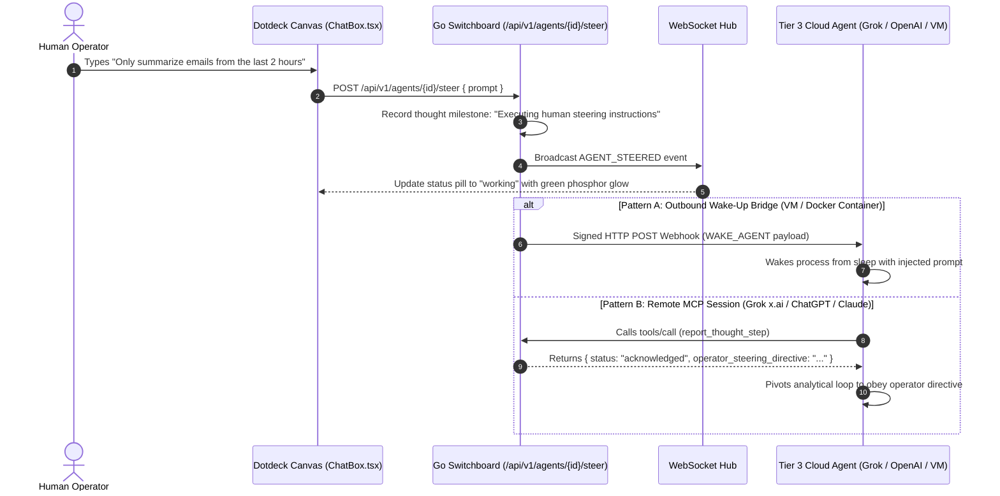

# Agent Steering Mechanics & Runtime Guidance

This document details the architecture, design principles, and concrete execution flows for **Human-in-the-Loop Agent Steering** within the Dotdeck Tier 3 Switchboard.

---

## 1. What Is "Steering"? (Steering vs. Chatting)

> [!IMPORTANT]
> **Steering is NOT a conversational chatbot.**
> Tier 3 closed cloud agents (OpenAI Dots, xAI Grok Bots, Meta Muse VMs, Claude Cloud Agents) execute autonomous background reasoning loops across cloud infrastructure. Steering is a human operator's **mid-flight flight-path control** to guide, constrain, or interrupt an agent without tearing down its execution topology or re-provisioning its credentials.

### Conceptual Comparison

| Dimension | Conventional Chatbot | Dotdeck Agent Steering |
| :--- | :--- | :--- |
| **Primary Interaction** | Conversational Q&A / Social dialog | Runtime flight-path adjustment & operational constraint |
| **Execution Model** | Request &rarr; Immediate text response | Continuous autonomous loop with multi-step tool execution |
| **Target Audience** | End-user asking for assistance | Swarm Operator monitoring mission-critical cloud swarms |
| **Operational Impact** | Ephemeral chat message | Mutates agent state, logs telemetry milestones, and injects directives into downstream tool execution |

---

## 2. Steering User Experience (Inspector Drawer)

When a workspace operator selects any active agent node on the canvas (such as `email summarizer`), the right-hand **Inspector Drawer** exposes the **Steering Terminal** at the bottom:

```text
> Inject steering instruction to email summarizer...
```

### Preset Directives

Above the custom prompt input, operators have access to 3 instant, standardized tactical directives:

1. **`+ Pause and summarize current state`**:
   - Instructs the agent to immediately halt its loop and dump its working memory trace to the Dotdeck Thought Stream for human auditing.
2. **`+ Require human sign-off on next action`**:
   - Forces the agent to suspend execution and invoke `ask_human_question()` before taking any further automated action.
3. **`+ Verify step output before continuing`**:
   - Commands the agent to execute an internal validation pass on its generated artifact before delegating it across the canvas topology.

---

## 3. Step-by-Step Execution Lifecycle

When an operator enters an instruction into the steering terminal and dispatches it (`[Enter]` or clicking **Steer**):



### Lifecycle Milestones

1. **Direct Injection into the Agent Timeline**:
   - The Go backend records an internal milestone event in the agent's partitioned telemetry log:
     ```json
     {
       "trace": "Only summarize emails from the last 2 hours",
       "next_step": "Executing human steering instructions",
       "tool": "human_steering",
       "steered_by": "usr-admin-01"
     }
     ```
   - The agent's status pill on the canvas immediately updates to `working` with an active phosphor glow.

2. **Real-time Canvas Notification**:
   - The backend broadcasts an `AGENT_STEERED` payload over the WebSocket hub to synchronize all collaborative canvas operators.

---

## 4. The Two Communication Delivery Patterns

How a steering directive reaches the agent depends on where and how the agent executes:

### Pattern A: Asynchronous Cloud Containers & VMs (Outbound Wake-Up Dispatch)

Used by **Meta Muse VMs**, self-hosted Docker runners, and internal enterprise agent containers.

- **Source Code**: [`backend/internal/bridge/dispatcher.go`](file:///C:/GithubProjects/Dotdeck/backend/internal/bridge/dispatcher.go) and [`backend/internal/bridge/webhook.go`](file:///C:/GithubProjects/Dotdeck/backend/internal/bridge/webhook.go)
- **Mechanism**:
  1. The agent's container runs an HTTP webhook listener (or Slack bot receiver).
  2. Dotdeck signs the request using an HMAC-SHA256 signature (`X-Dotdeck-Signature`) and posts a `WAKE_AGENT` payload:
     ```json
     {
       "event": "WAKE_AGENT",
       "agent_id": "2cb9d9f7-7700-4f9a-84b3-c5c7e6cc4c31",
       "agent_name": "email summarizer",
       "prompt": "Only summarize emails from the last 2 hours",
       "timestamp": "2026-10-28T14:05:49Z"
     }
     ```
  3. The container awakens the sleeping agent process, prepending the steering directive to its context window.

---

### Pattern B: Closed Web-Based Frontier Agents (Inbound MCP Tool Response)

Used by **xAI Grok on `x.ai`**, **OpenAI Custom GPTs**, and **Claude Web**.

> [!NOTE]
> Web-based frontier agents run in closed third-party cloud data centers. They **do not** expose a public inbound webhook port for Dotdeck to call into. Instead, they only establish outbound HTTPS connections to your Dotdeck MCP tunnel (`https://<tunnel-domain>/mcp/<agent_token>`).

- **Mechanism**:
  1. The operator dispatches a steering instruction in Dotdeck.
  2. Dotdeck's in-memory switchboard queues the steering directive in the agent's session buffer.
  3. When Grok or ChatGPT executes its regular heartbeat or analytical milestone via `report_thought_step`:
     ```json
     // Grok calls Dotdeck MCP
     {
       "jsonrpc": "2.0",
       "method": "tools/call",
       "params": {
         "name": "report_thought_step",
         "arguments": {
           "reasoning_trace": "Analyzing customer inbox...",
           "next_planned_step": "Extracting message headers"
         }
       }
     }
     ```
  4. Dotdeck dequeues the pending directive and returns it directly inside the tool call output:
     ```json
     // Dotdeck returns to Grok
     {
       "jsonrpc": "2.0",
       "result": {
         "status": "acknowledged",
         "operator_steering_directive": "Only summarize emails from the last 2 hours",
         "directive_priority": "CRITICAL"
       }
     }
     ```
  5. The LLM reads the tool output mid-flight and immediately pivots its next reasoning step to follow the human operator's directive.

---

## 5. Summary Matrix

| Frontier Agent Environment | Communication Model | Delivery Mechanism | Webhook Infrastructure Required? |
| :--- | :--- | :--- | :--- |
| **xAI Grok (`x.ai`)** | Inbound MCP Tunnel | Injected into tool result (`report_thought_step`) | **No** (works out-of-the-box over HTTPS tunnel) |
| **OpenAI Custom GPTs ("Dots")** | Inbound MCP Actions | Injected into tool result (`report_thought_step`) | **No** (works out-of-the-box over HTTPS tunnel) |
| **Claude Projects & Desktop** | Streamable HTTP / SSE | SSE stream push or tool response | **No** |
| **Meta Muse Secure VM** | Outbound Webhook Push | Signed HMAC-SHA256 HTTP POST (`WAKE_AGENT`) | **Yes** (`OUTBOUND_WEBHOOK_URL` configured) |
| **Slack Swarm Channel** | Outbound Bot API | Block Kit interactive wake message | **Yes** (`SLACK_BOT_TOKEN` configured) |
