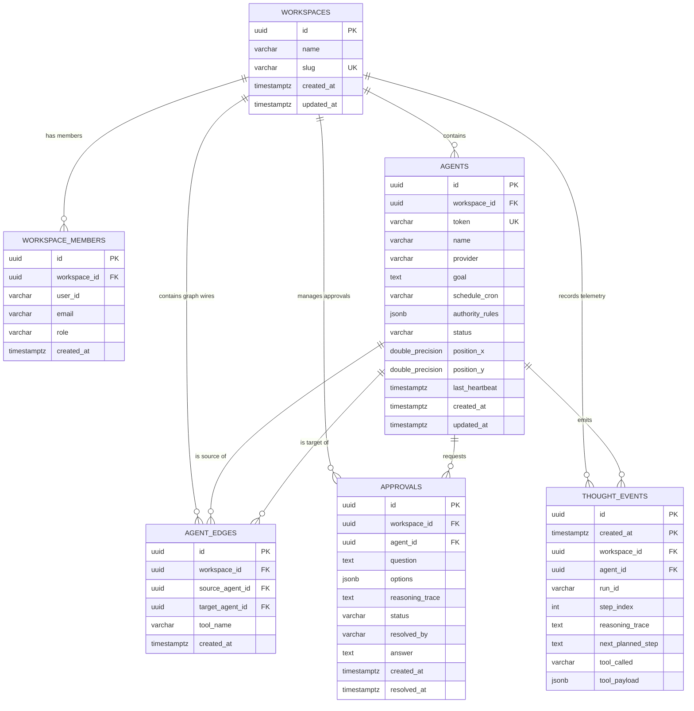
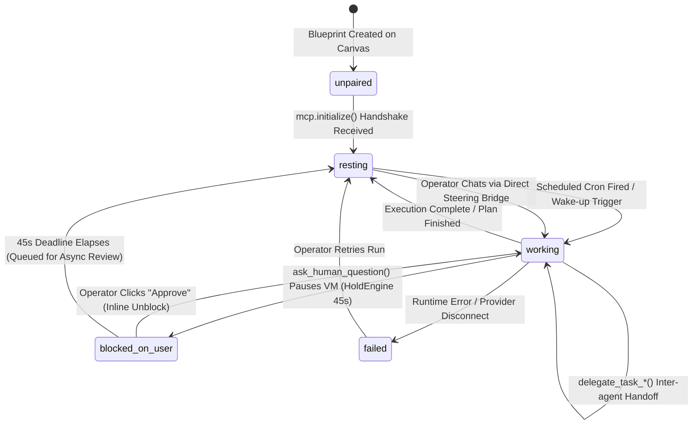

# Dotdeck Database Schema & Entity Relationship Specification

> **Target Engine**: PostgreSQL 16+ (with native monthly range partitioning)  
> **ORM & Driver**: `pgx/v5` with `sqlc` compiled type-safe interfaces  
> **Multi-Tenancy Model**: Tenant isolation bounded strictly by `workspace_id`  

---

## 1. Overview & Multi-Tenant Data Topology

Dotdeck organizes all autonomous closed cloud agents, canvas topology graphs, human-in-the-loop approvals, and continuous reasoning telemetry under **Workspaces**. 

Every core table enforces a foreign key back to `workspaces(id)` with `ON DELETE CASCADE`, ensuring hard multi-tenant boundaries. Analytical thought streams are stored in the `thought_events` table using **native PostgreSQL monthly range partitioning**, allowing high-throughput ingestion and instantaneous $O(1)$ pruning of 90-day-old partitions without database vacuum bloat.

---

## 2. Entity-Relationship Diagram (ERD)

The following diagram illustrates the relational database tables, primary keys, foreign keys, and cardinalities:



---

## 3. Go Domain Class Diagram

This diagram displays the object model and pure business domain types defined in `backend/internal/domain/`:

```mermaid
classDiagram
    class Workspace {
        +string ID
        +string Name
        +string Slug
        +time.Time CreatedAt
        +time.Time UpdatedAt
    }

    class WorkspaceMember {
        +string ID
        +string WorkspaceID
        +string UserID
        +string Email
        +Role Role
        +time.Time CreatedAt
    }

    class Role {
        <<enumeration>>
        RoleAdmin ("admin")
        RoleWrite ("write")
        RoleRead ("read")
    }

    class Agent {
        +string ID
        +string WorkspaceID
        +string Token
        +string Name
        +Provider Provider
        +string Goal
        +string ScheduleCron
        +[]string AuthorityRules
        +AgentStatus Status
        +float64 PositionX
        +float64 PositionY
        +*time.Time LastHeartbeat
        +time.Time CreatedAt
        +time.Time UpdatedAt
    }

    class Provider {
        <<enumeration>>
        ProviderOpenAIDot ("openai_dot")
        ProviderGrokBot ("grok_bot")
        ProviderMetaMuse ("meta_muse")
        ProviderClaude ("claude")
    }

    class AgentStatus {
        <<enumeration>>
        StatusUnpaired ("unpaired")
        StatusResting ("resting")
        StatusScheduled ("scheduled")
        StatusWorking ("working")
        StatusBlockedOnUser ("blocked_on_user")
        StatusFailed ("failed")
    }

    class Edge {
        +string ID
        +string WorkspaceID
        +string SourceAgentID
        +string TargetAgentID
        +string ToolName
        +time.Time CreatedAt
    }

    class ApprovalRequest {
        +string ID
        +string WorkspaceID
        +string AgentID
        +string Question
        +[]string Options
        +string ReasoningTrace
        +ApprovalStatus Status
        +time.Time CreatedAt
    }

    class ApprovalStatus {
        <<enumeration>>
        ApprovalStatusPending ("pending")
        ApprovalStatusApproved ("approved")
        ApprovalStatusRejected ("rejected")
        ApprovalStatusTimedOut ("timed_out")
    }

    class DecisionResult {
        +bool Approved
        +string Answer
        +string OperatorID
        +time.Time ResolvedAt
    }

    class ThoughtEvent {
        +string ID
        +string WorkspaceID
        +string AgentID
        +string RunID
        +int StepIndex
        +string ReasoningTrace
        +string NextPlannedStep
        +string ToolCalled
        +interface{} ToolPayload
        +time.Time CreatedAt
    }

    Workspace "1" *-- "many" WorkspaceMember : assigns
    Workspace "1" *-- "many" Agent : owns
    Workspace "1" *-- "many" Edge : manages
    WorkspaceMember o-- Role : enforces
    Agent o-- Provider : runs on
    Agent o-- AgentStatus : tracks
    Agent "1" *-- "many" Edge : source / target
    Agent "1" *-- "many" ApprovalRequest : triggers
    Agent "1" *-- "many" ThoughtEvent : emits
    ApprovalRequest o-- ApprovalStatus : transitions
    ApprovalRequest ..> DecisionResult : resolved by
```

---

## 4. Agent Execution State Machine

Cloud agents transition through 6 distinct execution states governed by MCP tool calls and human interaction:



---

## 5. Detailed Table Specifications

### 5.1 `workspaces` Table
The top-level multi-tenant container for agent fleets, canvases, and teams.

| Column | Type | Constraints | Default | Description |
| :--- | :--- | :--- | :--- | :--- |
| `id` | `UUID` | `PRIMARY KEY` | `gen_random_uuid()` | Unique workspace identifier |
| `name` | `VARCHAR(255)` | `NOT NULL` | - | Human-readable workspace name |
| `slug` | `VARCHAR(255)` | `UNIQUE NOT NULL` | - | URL-safe slug for routing (e.g. `acme-ai`) |
| `created_at` | `TIMESTAMPTZ` | `NOT NULL` | `NOW()` | Workspace creation timestamp |
| `updated_at` | `TIMESTAMPTZ` | `NOT NULL` | `NOW()` | Last configuration update timestamp |

---

### 5.2 `workspace_members` Table
Manages team collaborators and their role-based access rights within a workspace.

| Column | Type | Constraints | Default | Description |
| :--- | :--- | :--- | :--- | :--- |
| `id` | `UUID` | `PRIMARY KEY` | `gen_random_uuid()` | Unique membership record identifier |
| `workspace_id` | `UUID` | `REFERENCES workspaces(id) ON DELETE CASCADE` | - | Foreign key to owning workspace |
| `user_id` | `VARCHAR(255)` | `NOT NULL` | - | External auth or operator user identifier |
| `email` | `VARCHAR(255)` | `NOT NULL` | - | Teammate email address |
| `role` | `VARCHAR(50)` | `CHECK (role IN ('admin', 'write', 'read'))` | `'read'` | RBAC authorization level |
| `created_at` | `TIMESTAMPTZ` | `NOT NULL` | `NOW()` | Invitation / assignment timestamp |

**Indices**:
- `UNIQUE (workspace_id, user_id)`: Prevents duplicate membership records.
- `CREATE INDEX idx_workspace_members_workspace ON workspace_members(workspace_id);`

---

### 5.3 `agents` Table
Represents an autonomous Tier 3 closed cloud agent node on the visual canvas.

| Column | Type | Constraints | Default | Description |
| :--- | :--- | :--- | :--- | :--- |
| `id` | `UUID` | `PRIMARY KEY` | `gen_random_uuid()` | Unique agent node identifier |
| `workspace_id` | `UUID` | `REFERENCES workspaces(id) ON DELETE CASCADE` | - | Foreign key to parent workspace |
| `token` | `VARCHAR(64)` | `UNIQUE NOT NULL` | - | Secret pairing token used in `/mcp/{token}` URL |
| `name` | `VARCHAR(255)` | `NOT NULL` | - | Display name (e.g., `Sales Lead Researcher`) |
| `provider` | `VARCHAR(50)` | `CHECK (provider IN ('openai_dot', 'grok_bot', 'meta_muse', 'claude'))` | - | Closed cloud vendor hosting the agent VM |
| `goal` | `TEXT` | `NOT NULL` | `''` | Long-term objective injected into the agent |
| `schedule_cron` | `VARCHAR(100)` | `NOT NULL` | `''` | Cron expression or human schedule string |
| `authority_rules` | `JSONB` | `NOT NULL` | `'[]'::jsonb` | Array of prohibited or restricted operational rules |
| `status` | `VARCHAR(50)` | `CHECK (status IN ('unpaired', 'resting', 'scheduled', 'working', 'blocked_on_user', 'failed'))` | `'unpaired'` | Real-time execution lifecycle status |
| `position_x` | `DOUBLE PRECISION` | `NOT NULL` | `0.0` | React Flow canvas X coordinate |
| `position_y` | `DOUBLE PRECISION` | `NOT NULL` | `0.0` | React Flow canvas Y coordinate |
| `last_heartbeat` | `TIMESTAMPTZ` | `NULL` | `NULL` | Timestamp of the most recent MCP tool interaction |
| `created_at` | `TIMESTAMPTZ` | `NOT NULL` | `NOW()` | Agent creation timestamp |
| `updated_at` | `TIMESTAMPTZ` | `NOT NULL` | `NOW()` | Last state or position change timestamp |

**Indices**:
- `CREATE INDEX idx_agents_token ON agents(token);`: Instant sub-millisecond lookup on every `/mcp/{token}` tool request.
- `CREATE INDEX idx_agents_workspace ON agents(workspace_id);`: Fast canvas graph rendering per workspace.

---

### 5.4 `agent_edges` Table
Represents a directed communication wire connecting two agents on the canvas.

| Column | Type | Constraints | Default | Description |
| :--- | :--- | :--- | :--- | :--- |
| `id` | `UUID` | `PRIMARY KEY` | `gen_random_uuid()` | Unique edge identifier |
| `workspace_id` | `UUID` | `REFERENCES workspaces(id) ON DELETE CASCADE` | - | Foreign key to parent workspace |
| `source_agent_id` | `UUID` | `REFERENCES agents(id) ON DELETE CASCADE` | - | Initiating agent (caller) |
| `target_agent_id` | `UUID` | `REFERENCES agents(id) ON DELETE CASCADE` | - | Receiving agent (callee) |
| `tool_name` | `VARCHAR(255)` | `NOT NULL` | - | Synthesized tool name (e.g. `delegate_task_to_grok_bot`) |
| `created_at` | `TIMESTAMPTZ` | `NOT NULL` | `NOW()` | Connection timestamp |

**Indices**:
- `UNIQUE (workspace_id, source_agent_id, target_agent_id)`: Prevents duplicate wires between the same pair of nodes.
- `CREATE INDEX idx_agent_edges_workspace ON agent_edges(workspace_id);`

---

### 5.5 `approvals` Table
Records synchronous and asynchronous human-in-the-loop decisions emitted via `ask_human_question()`.

| Column | Type | Constraints | Default | Description |
| :--- | :--- | :--- | :--- | :--- |
| `id` | `UUID` | `PRIMARY KEY` | `gen_random_uuid()` | Unique approval request identifier |
| `workspace_id` | `UUID` | `REFERENCES workspaces(id) ON DELETE CASCADE` | - | Foreign key to parent workspace |
| `agent_id` | `UUID` | `REFERENCES agents(id) ON DELETE CASCADE` | - | Agent requesting human authorization |
| `question` | `TEXT` | `NOT NULL` | - | Decision description requiring approval |
| `options` | `JSONB` | `NOT NULL` | `'[]'::jsonb` | Quick-select choice pills (e.g., `["Approve", "Deny"]`) |
| `reasoning_trace` | `TEXT` | `NOT NULL` | `''` | Agent's internal justification for asking |
| `status` | `VARCHAR(50)` | `CHECK (status IN ('pending', 'approved', 'rejected', 'timed_out'))` | `'pending'` | Resolution state |
| `resolved_by` | `VARCHAR(255)` | `NULL` | `NULL` | Operator identifier who made the decision |
| `answer` | `TEXT` | `NULL` | `NULL` | Human feedback or instruction string |
| `created_at` | `TIMESTAMPTZ` | `NOT NULL` | `NOW()` | When the question was posed by the agent |
| `resolved_at` | `TIMESTAMPTZ` | `NULL` | `NULL` | When the human answered or timeout elapsed |

**Indices**:
- `CREATE INDEX idx_approvals_workspace_status ON approvals(workspace_id, status);`: Enables instant filtering of pending approval queues.

---

### 5.6 `thought_events` Table (Monthly Partitioned)
High-throughput append-only log of agent reasoning steps, intermediate hypotheses, and next planned actions.

| Column | Type | Constraints | Default | Description |
| :--- | :--- | :--- | :--- | :--- |
| `created_at` | `TIMESTAMPTZ` | `PRIMARY KEY (Part 1)` | `NOW()` | Partition key: timestamp of the reasoning step |
| `id` | `UUID` | `PRIMARY KEY (Part 2)` | `gen_random_uuid()` | Unique event identifier |
| `workspace_id` | `UUID` | `REFERENCES workspaces(id) ON DELETE CASCADE` | - | Foreign key to parent workspace |
| `agent_id` | `UUID` | `REFERENCES agents(id) ON DELETE CASCADE` | - | Agent emitting the reasoning step |
| `run_id` | `VARCHAR(64)` | `NOT NULL` | `''` | Correlation identifier for a continuous execution run |
| `step_index` | `INT` | `NOT NULL` | `0` | Sequential step number in the execution run |
| `reasoning_trace` | `TEXT` | `NOT NULL` | - | Chain-of-thought hypothesis or analytical insight |
| `next_planned_step` | `TEXT` | `NOT NULL` | `''` | Immediate downstream action planned by the agent |
| `tool_called` | `VARCHAR(255)` | `NOT NULL` | `''` | Tool invoked at this milestone (if any) |
| `tool_payload` | `JSONB` | `NULL` | `NULL` | Structured tool input arguments or delegation data |

**Partition Structure**:
```sql
PARTITION BY RANGE (created_at);

-- Pre-allocated partitions
thought_events_2026_10 (2026-10-01 to 2026-11-01)
thought_events_2026_11 (2026-11-01 to 2026-12-01)
thought_events_2026_12 (2026-12-01 to 2027-01-01)
thought_events_default (Fallback partition)
```

**Indices**:
- `CREATE INDEX idx_thought_events_agent ON thought_events(agent_id, created_at DESC);`: Optimizes the Slide-Out Inspector virtualized feed.
- `CREATE INDEX idx_thought_events_workspace ON thought_events(workspace_id, created_at DESC);`: Supports workspace-wide audit stream queries.

---

## 6. Cascade & Consistency Rules

1. **Workspace Deletion (`ON DELETE CASCADE`)**:
   - Deleting a workspace automatically purges all associated members, agents, edges, approvals, and thought events in a single atomic transaction.
2. **Agent Deletion (`ON DELETE CASCADE`)**:
   - Deleting an agent node on the canvas purges its inbound and outbound edges (`agent_edges`), any pending approvals, and historical thoughts.
3. **Double-Approval Anti-Collision**:
   - Simultaneous operator resolution uses atomic SQL:
     ```sql
     UPDATE approvals
     SET status = $2, resolved_by = $3, answer = $4, resolved_at = NOW()
     WHERE id = $1 AND status = 'pending'
     RETURNING *;
     ```
   - Only the first operator's query updates a row; the second receives 0 rows affected, guaranteeing single-winner resolution.
