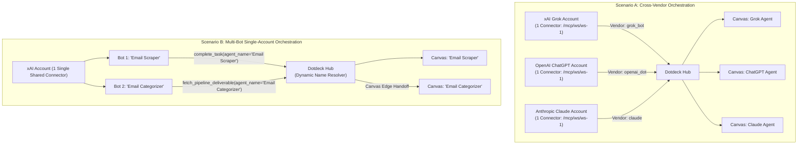
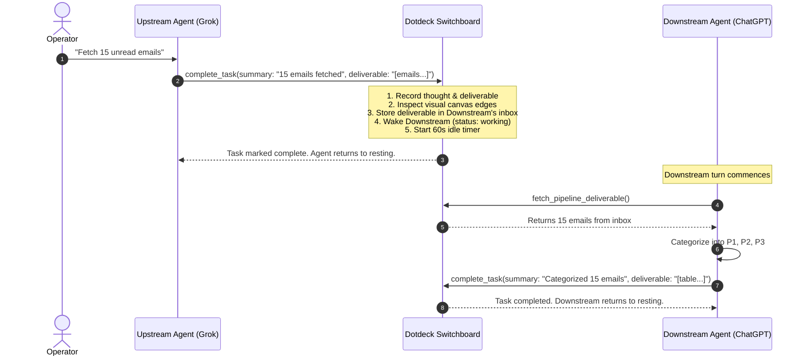

# Multi-Agent Cross-Vendor Orchestration, Connector Routing & Zero-Touch Execution

This document details the architectural mechanisms Dotdeck uses to coordinate **Tier 3 Closed Cloud Agents** (OpenAI Dots, Grok Bots, Meta Muse, and Claude Cloud Agents) without tool collisions, token waste, or requiring per-token developer API keys.

---

## 1. Executive Summary & The Problem Space

Modern enterprise AI workflows increasingly rely on specialized cloud agents hosted on proprietary vendor platforms:
* **xAI Grok Bots**: Uncensored live web scraping, social media analysis, real-time X search.
* **OpenAI Dots / ChatGPT**: Mathematical reasoning, function calling, deep logical synthesis.
* **Anthropic Claude Projects**: Nuanced prose generation, code verification, long-form artifact drafting.

However, because these models run inside **closed vendor cloud sandboxes**, they suffer from three fundamental limitations:
1. **Walled Gardens**: OpenAI models cannot directly talk or connect to xAI or Anthropic models over the public internet.
2. **Account-Wide Connector Sharing**: When an MCP server or connector is registered in a vendor account (e.g. xAI Grok), it is installed **account-wide**. Every single bot created under that account automatically inherits all registered connectors.
3. **No Native DAG or State Engine**: Chat interfaces provide linear, conversational streams. They lack directed graph dependencies, versioned pipeline inboxes, and human authority gating.

Dotdeck solves these problems by acting as a **vendor-neutral Model Context Protocol (MCP) switchboard and execution DAG**.

---

## 2. The "Account-Wide Connector" Challenge ($5 \times N$ Tool Explosion Trap)

In consumer and business AI platforms (such as xAI Grok for Business and OpenAI Custom GPTs), connectors and tools are registered at the **account level**, not the individual bot level:

> *"Connectors are installed account-wide, meaning they are shared across all of your bots. When you install a custom MCP server, it becomes available to every single bot on your account."*

### The Naïve Failure Mode: Per-Agent Connectors
If a user creates 5 Grok bots on one account and naively tries to install 5 separate MCP connectors (one pointing to each agent's endpoint):
* Connector 1 (Bot A) exposes tools: `complete_task`, `fetch_pipeline_deliverable`, `report_thought_step`
* Connector 2 (Bot B) exposes tools: `complete_task`, `fetch_pipeline_deliverable`, `report_thought_step`
* ...
* Connector 5 (Bot E) exposes tools: `complete_task`, `fetch_pipeline_deliverable`, `report_thought_step`

Because connectors are account-wide, **every single Grok bot on that account sees all 5 connectors simultaneously**:
$$\text{Total Tools Visible Per Bot} = 5 \text{ connectors} \times N \text{ tools} = 5N \text{ tools}$$

This causes:
1. **Tool Name Collisions**: Multiple identical tool definitions or confusing prefixed tools (`connector_1_complete_task`, `connector_2_complete_task`).
2. **LLM Hallucinations**: Bot A mistakenly calls Bot C's connector, writing deliverables into the wrong pipeline inbox.
3. **Context Window Waste**: Bloated system prompts containing dozens of redundant tool definitions.

---

## 3. The Dotdeck Routing Solution

Dotdeck resolves connector scoping through a two-tier routing architecture:



### 3.1 Cross-Vendor Teams (Account-Level Isolation)
When agents belong to different cloud providers (e.g., 1 Grok bot, 1 ChatGPT Dot, 1 Claude Project):
* Each vendor account registers **only 1 MCP connector** pointing to the Dotdeck workspace hub (`/mcp/ws/{workspace_id}`).
* Dotdeck inspects the incoming handshake headers (`User-Agent`, client signatures) via `inferProvider()`.
* Dotdeck automatically binds incoming traffic to the matching provider agent node on the canvas.
* **Result**: Exactly 4 tools visible per bot, zero tool duplication, zero collisions.

### 3.2 Single-Account Multi-Bot Teams (Dynamic `agent_name` Resolution)
When multiple bots operate within the **same vendor account** (e.g. 5 Grok bots on one xAI subscription):
1. **Single Connector Rule**: The user installs **only 1 single Dotdeck connector** for the entire workspace.
2. **Standard 4-Tool Catalog**: Every bot sees exactly the same 4 clean tools (no $5 \times N$ explosion).
3. **Dynamic Persona Identity**: Dotdeck tool schemas include an optional `agent_name` argument:
   - `report_thought_step(reasoning_trace, next_planned_step, agent_name)`
   - `complete_task(summary, deliverable, agent_name)`
   - `fetch_pipeline_deliverable(agent_name)`
4. **Instruction-Level Binding**: In each bot's custom instructions/prompt, the operator specifies its canvas name:
   > *"You are 'Email Scraper' on Dotdeck. When invoking Dotdeck MCP tools, always pass `agent_name='Email Scraper'`."*
5. **Runtime Resolution**: When `handleToolCall` executes, Dotdeck matches `agent_name` against the workspace graph, binding execution to that specific canvas node:
   ```go
   callingContext := agentContext
   if explicitAgentName, hasName := callArguments.Arguments["agent_name"].(string); hasName && explicitAgentName != "" {
       if matchedContext, err := server.repository.GetAgentByWorkspaceAndName(agentContext.WorkspaceID, explicitAgentName); err == nil && matchedContext != nil {
           callingContext = matchedContext
       }
   }
   ```

---

## 4. Deliverable Pipeline Ingestion (DAG Execution Model)

Dotdeck replaces messy conversational back-and-forth with structured, token-efficient DAG execution:



### Key Execution Guarantees
1. **Strict DAG Sequencing**: Downstream agents do not see upstream conversational noise or chat formatting; they receive clean, versioned deliverable artifacts.
2. **60-Second Inactivity Idle Timer**: When Dotdeck wakes a downstream agent with `status: working`, an internal idle timer begins. If no tool calls occur within 60 seconds, the agent returns to `resting` to prevent stale UI states.
3. **Cyclic Rate-Limit Guard**: If two agents are wired in a loop, Dotdeck enforces a circuit breaker halting execution if more than 5 handoffs occur within a 10-minute window without human review.

---

## 5. Zero-Touch Autonomous Orchestration (No API Keys Required)

A core commercial advantage of Dotdeck is orchestrating Tier 3 closed cloud agents **without requiring per-token developer API keys**:

| Pattern | Zero-Touch Mechanism | Setup Complexity | API Key Required? |
| :--- | :--- | :---: | :---: |
| **Pattern 1: Held MCP Connection Loop** | Agent calls `wait_for_pipeline_task()`; Dotdeck holds HTTP request open until upstream delivers. | Low (Single initial prompt) | ❌ **No** |
| **Pattern 2: Browser Sidecar / Extension Relay** | Lightweight background extension / CDP script automatically injects trigger prompt into logged-in web tab upon Dotdeck WebSocket signal. | Medium (Local extension) | ❌ **No** |
| **Pattern 3: Asynchronous Webhook / Slack Bridge** | Dotdeck fires incoming webhook to private Slack workspace: `@ChatGPT Process latest pipeline deliverable`. | Low (Standard Slack bot app) | ❌ **No** |
| **Pattern 4: Background Cloud Runner (Optional)** | Dotdeck invokes vendor Assistant / Cloud API directly via developer key. | Low | Optional (Pay-per-token) |

---

## 6. Why Slack / Discord Bots Cannot Replace Dotdeck

A common misconception is that cross-bot orchestration could be handled simply by inviting multiple AI bots into a shared Slack or Discord channel. In practice, this fails for five architectural reasons:

1. **Bot-to-Bot Event Suppression**: By design, Slack's Event API ignores messages sent by other bots (`subtype: bot_message`) to prevent runaway infinite loops and spam. Chaining bots requires custom middleware backend code—which is Dotdeck.
2. **Unstructured Chat Wall vs. Visual DAG**: In a chat channel, bots talk over each other in an unsequenced text thread. In Dotdeck, dependencies, execution order, and agent statuses (`resting`, `working`, `blocked_on_user`) are strictly enforced by a visual graph.
3. **Structured Schemas vs. Conversational Noise**: Dotdeck passes clean, versioned JSON deliverables. In Slack, an agent must attempt fuzzy regex parsing of another bot's conversational chat, emojis, and preamble.
4. **Held Authority Gateways**: Dotdeck provides HTTP-layer tool pauses (`ask_human_question`) where dangerous actions freeze until an operator clicks Approve on the dashboard. Chat bots have binary all-or-nothing channel permissions.
5. **Real-Time Telemetry & Chain-of-Thought**: Dotdeck captures internal reasoning traces (`<thought>`), tool parameters, and execution runs into an inspectable drawer. Chat feeds expose none of this.

---

## 7. Comparative Architecture Matrix

| Dimension | Naïve Multi-Connector Setup | Slack / Discord Group Chat | Dotdeck Autonomous Hub |
| :--- | :---: | :---: | :---: |
| **Tool Count** | $N \times \text{Agents}$ (Explosion) | N/A (Chat text only) | **4 tools constant** |
| **Cross-Vendor Support** | ❌ Walled garden only | ⚠️ Fragmented | ✅ **Universal MCP Switchboard** |
| **Token Efficiency** | ⚠️ Chat banter burn | ❌ High infinite loop risk | ✅ **Targeted DAG deliverable handoff** |
| **Security Boundary** | ❌ Shared credentials across all bots | ❌ Channel-wide visibility | ✅ **Per-agent token & Held Approvals** |
| **API Key Requirement** | Optional | Optional | ✅ **Pure MCP (Zero API keys required)** |
| **Execution Observability** | None | Message history only | ✅ **Live Thought Stream & Deliverable Drawer** |
