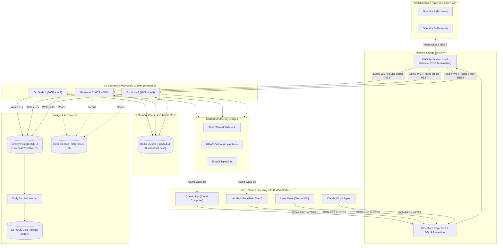
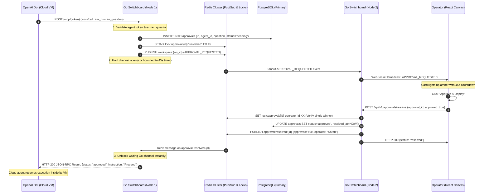

# System Design Specification: Dotdeck Cloud Agent Switchboard

> **Status**: Approved  
> **Author**: Antigravity Principal Systems Architect  
> **Baseline Target Scale**: Growth Stage (500 Organizations, 5,000 Concurrent Cloud Agents, 2.5M Daily Events)  
> **Primary SLA**: 99.95% Availability, P95 MCP Ingestion < 25ms, P95 Approval Unblock < 50ms, WebSocket Broadcast < 15ms  

---

## 1. Executive Summary & System Context

Dotdeck is a vendor-neutral cross-vendor orchestration, visualization, and human-in-the-loop governance switchboard designed specifically for **Tier 3 closed cloud agents** (OpenAI Dots, xAI Grok Bots, Meta Muse, and Claude Cloud Agents). 

Unlike local terminal-based agent harnesses, Tier 3 agents run inside proprietary cloud virtual machines where external code execution, terminal access, and direct inbound network connections are completely locked down by vendor security perimeters. Dotdeck solves this "walled garden" dilemma by inverting the network topology: rather than attempting to manage remote VMs directly, Dotdeck acts as an ultra-low-latency **Remote Model Context Protocol (MCP) Tool Server** and **Multiplayer Real-Time Switchboard**.

Closed cloud agents connect outbound to unique multi-tenant endpoints (`/mcp/{agent_token}`) over HTTP/SSE. Dotdeck injects mandatory telemetry and delegation tools into their prompt space, holds HTTP connections open synchronously for human approval gates (`HoldEngine`), wakes sleeping agents via outbound webhook/chat bridges, and streams analytical thoughts and presence to an interactive React Flow canvas.

---

## 2. Requirements & Boundary Definition

### 2.1 Functional Requirements (Core Capabilities)
- **[FR-1] Multi-Tenant MCP Tool Switchboard**: Expose dynamic JSON-RPC 2.0 endpoints (`/mcp/{agent_token}`) serving standard tool definitions (`report_thought_step`, `ask_human_question`) and dynamic delegation tools synthesized from visual canvas edges.
- **[FR-2] Synchronous Human Approval Loop (`HoldEngine`)**: When an agent calls `ask_human_question()`, pause the agent's cloud VM HTTP/SSE tool-call connection for up to **45 seconds** awaiting human operator resolution via the canvas UI or REST API.
- **[FR-3] Outbound Wake-Up Bridges**: When an agent is resting (asleep between schedules), steer and awaken it via outbound triggers (Slack threads, HMAC-signed webhooks, email triggers) directly from the Dotdeck UI.
- **[FR-4] Real-Time Multiplayer Canvas**: Synchronize agent states (`Resting`, `Scheduled`, `Working`, `Blocked on Human`, `Failed`), animated pulse edges, thought tickers, and collaborator cursor presence across multiple browser sessions.
- **[FR-5] Optimistic Anti-Collision Locking**: Prevent two human teammates from submitting conflicting answers to the same pending approval simultaneously.

### 2.2 Non-Functional Requirements (Qualities of Service)
- **Availability Target**: **99.95% uptime** (< 4.38 hours of unscheduled downtime per year).
- **Latency Budgets**:
  - MCP Telemetry Ingestion (`report_thought_step`): P95 < 25ms, P99 < 60ms.
  - Synchronous Approval Unblock (`HoldEngine` resolution to agent): P95 < 50ms, P99 < 100ms.
  - WebSocket Event Broadcast Fanout: P95 < 15ms from event ingestion to client receipt.
- **Consistency Model**:
  - **Strong Consistency (Linearizable)**: Workspace membership, RBAC policies, and Approval decision resolutions (guaranteed single-resolution via atomic locks).
  - **Eventual Consistency**: Cursor presence updates (drop-on-lag) and cold thought stream archives.
- **Data Durability**: Zero data loss for completed approval audits, active workspace graphs, and agent identities. Automated daily point-in-time recovery (PITR) with WAL archiving.

### 2.3 Explicit Non-Goals (Out of Scope for v1)
- **[NG-1] No Local POSIX PTY Execution**: We do not spawn, host, or manage local OS processes, Docker containers, or terminal windows on the user's local machine.
- **[NG-2] No Model Weight Hosting / Local LLM Inference**: All intelligence resides inside proprietary cloud vendor VMs (OpenAI, xAI, Meta, Anthropic).
- **[NG-3] No Arbitrary Inbound Port Tunneling (ngrok/localtunnel)**: Dotdeck runs in public cloud infrastructure behind TLS load balancers; agents reach Dotdeck via standard outbound HTTPS.

---

## 3. Back-of-the-Envelope Capacity Estimations

The following calculations baseline Dotdeck for **Growth Stage Production** (~500 organizations, 5,000 active concurrent agents, 2,500 simultaneous human operators).

```
┌────────────────────────────────────────────────────────────────────────┐
│                   CAPACITY ESTIMATION SUMMARY SHEET                    │
├───────────────────────────────┬────────────────────────────────────────┤
│ Metric                        │ Sizing Value                           │
├───────────────────────────────┼────────────────────────────────────────┤
│ Active Organizations          │ 500 orgs                               │
│ Concurrent Cloud Agents       │ 5,000 agents                           │
│ Concurrent Human Operators    │ 2,500 active browser sessions          │
│ Daily Thought & Tool Events   │ 2,500,000 events / day                 │
│ Ingestion Write QPS (Avg/Peak)│ 29 writes/sec avg  / 87 writes/sec peak│
│ WebSocket Fanout QPS (Peak)   │ 218 msgs/sec (events) + 25k ticks/sec  │
│ Daily Data Ingestion          │ 5.0 GB / day                           │
│ 90-Day Hot/Warm DB Storage    │ 585 GB (PostgreSQL with indices)       │
│ 1-Year Cold Archive Storage   │ 550 GB (Parquet compressed on S3)      │
│ Redis Cache Memory RAM        │ 2.0 GB (8 GB allocated with 4x margin) │
│ Egress Network Bandwidth      │ 28.5 Mbps peak                         │
└───────────────────────────────┴────────────────────────────────────────┘
```

### 3.1 Throughput & Concurrency Calculations
1. **Daily Event Ingestion**:
   $$\text{Daily Writes} = 2,500,000 \text{ events/day}$$
   $$\text{Average Ingestion QPS} = \frac{2,500,000}{86,400} \approx 28.93 \text{ writes/sec}$$
   $$\text{Peak Ingestion QPS} = 28.93 \times 3.0 \approx 87 \text{ writes/sec}$$
   *(Note: Bursts up to 150 QPS during top-of-the-hour cron schedule sweeps).*

2. **WebSocket Fanout & Presence Throughput**:
   - Average active collaborators viewing a live workspace: 2.5 operators.
   - Peak thought broadcast rate: $87 \times 2.5 \approx 218 \text{ msgs/sec}$.
   - Cursor presence: 2,500 operators moving cursors throttled to 10 Hz:
     $$\text{Peak Cursor Ticks} = 2,500 \times 10 = 25,000 \text{ ticks/sec}$$
     *(Because workspaces are strictly isolated rooms, each room only handles ~50 ticks/sec across its active viewers).*

### 3.2 Storage Sizing
1. **Average Thought Event Record**:
   - `id` (UUID: 16B) + `workspace_id` (16B) + `agent_id` (16B) + `step_index` (4B) + `reasoning_trace` (~1,000B text) + `next_planned_step` (~200B) + `tool_called` & `payload` (~500B) + `created_at` (8B) + JSON overhead $\approx 2.0\text{ KB}$.
2. **Daily Ingestion Volume**:
   $$\text{Daily Storage} = 2,500,000 \times 2.0\text{ KB} = 5.0\text{ GB / day}$$
3. **90-Day Hot/Warm Tier (PostgreSQL)**:
   $$\text{90-Day Raw Data} = 5.0\text{ GB} \times 90 = 450\text{ GB}$$
   $$\text{Index Overhead (B-Tree + Composite)} = 450\text{ GB} \times 0.30 = 135\text{ GB}$$
   $$\text{Total 90-Day Hot DB Volume} = 450 + 135 = 585\text{ GB}$$
4. **1-Year Cold Archive (S3 / Parquet)**:
   - Compressed Parquet ratio: ~70% reduction ($5.0\text{ GB} \times 0.30 = 1.5\text{ GB/day}$).
   - 1-Year Cold Size: $1.5\text{ GB} \times 365 \approx 547.5\text{ GB}$.

### 3.3 Cache & RAM Sizing (Redis)
Applying the **80/20 Pareto principle** to cache hot workspace state:
- Recent 20 thought steps for 5,000 active agents: $5,000 \times 20 \times 2\text{ KB} = 200\text{ MB}$.
- Ephemeral cursor coordinates (2,500 users): $2,500 \times 200\text{ B} \approx 500\text{ KB}$.
- In-flight approval hold records (~200 concurrent holds): $200 \times 4\text{ KB} \approx 800\text{ KB}$.
- Pub/Sub message buffering: ~200 MB.
- **Total Redis RAM Sizing**: ~600 MB. Allocated **2 GB** (or an 8 GB AWS `cache.m6g.large` node for 13x headroom).

---

## 4. High-Level Architecture & Blueprint



### Component Roles & Responsibilities

1. **Ingress Layer (Cloudflare + ALB)**: Terminates TLS 1.3, mitigates DDoS attacks, handles HTTP/2 connection pooling, and distributes `/mcp/*`, `/api/v1/*`, and `/ws` traffic.
2. **Stateless Go Switchboard Cluster (`backend/`)**:
   - **`/mcp/{agent_token}`**: Multi-tenant MCP endpoint. Validates tokens, checks agent state, executes tools, and holds synchronous connections.
   - **`HoldEngine`**: In-memory channel registry paired with Redis distributed resolution keys.
   - **`websocket.Hub`**: Manages isolated workspace rooms, cursor positions, and fan-out.
3. **Redis Cluster (In-Memory Pub/Sub & Coordination)**:
   - Synchronizes WebSocket messages across Go nodes (`PUBLISH workspace:{id}:events`).
   - Distributes approval resolution events across nodes: if Agent is held on Node 1, and Operator submits approval to Node 3, Node 3 publishes to Redis, and Node 1 unblocks the held channel in < 5ms.
4. **PostgreSQL 16 (Relational & Partitioned Storage)**:
   - Primary persistence for Workspaces, Members, Agents, Edges, Approvals, and Thought Events.
   - Partitioned by month on `created_at` for high-throughput append-only ingestion and 90-day pruning.
5. **Cold Archival Pipeline**:
   - Cron worker converts 90+ day partitions into compressed Parquet files and offloads them to S3/GCS with Glacier lifecycle transitions.

---

## 5. Synchronous Hold & Cross-Node Resolution Lifecycle

The core innovation of Dotdeck is holding cloud agent tool-calls open while human operators deliberate. When running a horizontally scaled cluster, cross-node coordination is required:



---

## 6. Data Model & Storage Design

### 6.1 Core PostgreSQL Schema (DDL)

```sql
-- Workspaces (Tenant isolation boundary)
CREATE TABLE workspaces (
    id UUID PRIMARY KEY DEFAULT gen_random_uuid(),
    name VARCHAR(100) NOT NULL,
    slug VARCHAR(100) UNIQUE NOT NULL,
    created_at TIMESTAMPTZ NOT NULL DEFAULT NOW(),
    updated_at TIMESTAMPTZ NOT NULL DEFAULT NOW()
);

-- Workspace Members & RBAC
CREATE TABLE workspace_members (
    id UUID PRIMARY KEY DEFAULT gen_random_uuid(),
    workspace_id UUID NOT NULL REFERENCES workspaces(id) ON DELETE CASCADE,
    user_id VARCHAR(64) NOT NULL,
    email VARCHAR(255) NOT NULL,
    role VARCHAR(20) NOT NULL CHECK (role IN ('admin', 'write', 'read')),
    created_at TIMESTAMPTZ NOT NULL DEFAULT NOW(),
    UNIQUE (workspace_id, user_id)
);

-- Cloud Agents (Tier 3 entities)
CREATE TABLE agents (
    id UUID PRIMARY KEY DEFAULT gen_random_uuid(),
    workspace_id UUID NOT NULL REFERENCES workspaces(id) ON DELETE CASCADE,
    token VARCHAR(64) UNIQUE NOT NULL,
    name VARCHAR(100) NOT NULL,
    provider VARCHAR(30) NOT NULL CHECK (provider IN ('openai_dot', 'grok_bot', 'meta_muse', 'claude')),
    goal TEXT NOT NULL,
    schedule_cron VARCHAR(50),
    authority_rules JSONB NOT NULL DEFAULT '[]'::jsonb,
    status VARCHAR(30) NOT NULL DEFAULT 'unpaired' CHECK (status IN ('unpaired', 'resting', 'scheduled', 'working', 'blocked_on_user', 'failed')),
    position_x DOUBLE PRECISION NOT NULL DEFAULT 0.0,
    position_y DOUBLE PRECISION NOT NULL DEFAULT 0.0,
    last_heartbeat TIMESTAMPTZ,
    created_at TIMESTAMPTZ NOT NULL DEFAULT NOW(),
    updated_at TIMESTAMPTZ NOT NULL DEFAULT NOW()
);

-- Canvas Edges (Directed delegation wiring)
CREATE TABLE agent_edges (
    id UUID PRIMARY KEY DEFAULT gen_random_uuid(),
    workspace_id UUID NOT NULL REFERENCES workspaces(id) ON DELETE CASCADE,
    source_agent_id UUID NOT NULL REFERENCES agents(id) ON DELETE CASCADE,
    target_agent_id UUID NOT NULL REFERENCES agents(id) ON DELETE CASCADE,
    tool_name VARCHAR(100) NOT NULL,
    created_at TIMESTAMPTZ NOT NULL DEFAULT NOW(),
    UNIQUE (workspace_id, source_agent_id, target_agent_id)
);

-- Approvals (Human-in-the-loop decision records)
CREATE TABLE approvals (
    id UUID PRIMARY KEY DEFAULT gen_random_uuid(),
    workspace_id UUID NOT NULL REFERENCES workspaces(id) ON DELETE CASCADE,
    agent_id UUID NOT NULL REFERENCES agents(id) ON DELETE CASCADE,
    question TEXT NOT NULL,
    options JSONB NOT NULL DEFAULT '[]'::jsonb,
    reasoning_trace TEXT NOT NULL,
    status VARCHAR(30) NOT NULL DEFAULT 'pending' CHECK (status IN ('pending', 'approved', 'rejected', 'timed_out')),
    resolved_by VARCHAR(64),
    answer TEXT,
    resolved_at TIMESTAMPTZ,
    created_at TIMESTAMPTZ NOT NULL DEFAULT NOW()
);

-- Thought Events (Partitioned by month for high-throughput append & pruning)
CREATE TABLE thought_events (
    id UUID NOT NULL DEFAULT gen_random_uuid(),
    workspace_id UUID NOT NULL REFERENCES workspaces(id) ON DELETE CASCADE,
    agent_id UUID NOT NULL REFERENCES agents(id) ON DELETE CASCADE,
    run_id UUID NOT NULL,
    step_index INT NOT NULL,
    reasoning_trace TEXT NOT NULL,
    next_planned_step TEXT NOT NULL,
    tool_called VARCHAR(100),
    tool_payload JSONB,
    created_at TIMESTAMPTZ NOT NULL DEFAULT NOW(),
    PRIMARY KEY (created_at, id)
) PARTITION BY RANGE (created_at);

-- Monthly Partition Tables (Example)
CREATE TABLE thought_events_2026_10 PARTITION OF thought_events
    FOR VALUES FROM ('2026-10-01 00:00:00+00') TO ('2026-11-01 00:00:00+00');
CREATE TABLE thought_events_2026_11 PARTITION OF thought_events
    FOR VALUES FROM ('2026-11-01 00:00:00+00') TO ('2026-12-01 00:00:00+00');

-- Indices for rapid query access
CREATE INDEX idx_agents_token ON agents (token);
CREATE INDEX idx_agents_workspace ON agents (workspace_id);
CREATE INDEX idx_approvals_pending ON approvals (workspace_id, status) WHERE status = 'pending';
CREATE INDEX idx_thought_events_agent_stream ON thought_events (agent_id, created_at DESC);
```

---

## 7. Deep Dive: Architectural Trade-Off Decisions ("Why X Over Y")

### 7.1 Backend Language: Go vs. Node.js / Python
- **Selected**: **Go 1.25+**
- **Alternative Considered**: Node.js (TypeScript) / Python (FastAPI)
- **Rationale**:
  - *Why Selected*: The core architectural challenge is **holding thousands of 45-second concurrent HTTP requests** waiting for human intervention without exhausting system memory or event loops. Go's lightweight runtime costs only ~2 KB of stack space per goroutine, allowing a single 4-core instance to effortlessly hold 50,000+ open channels. Node.js single-thread event loop and Python ASGI coroutines introduce event loop lag and higher memory footprint under thousands of simultaneous open SSE streams.
  - *Trade-off Accepted*: Less ubiquitous dynamic JSON reflection compared to JavaScript; mitigated by compile-time type safety and `sqlc` code generation.

### 7.2 Persistence: PostgreSQL Partitioning vs. MongoDB / Cassandra
- **Selected**: **PostgreSQL 16 with Native Range Partitioning**
- **Alternative Considered**: MongoDB or Apache Cassandra
- **Rationale**:
  - *Why Selected*: Dotdeck requires strict relational consistency for multi-tenant workspaces, RBAC memberships, and atomic approval single-resolution guarantees (avoiding double-spending or conflicting human instructions). PostgreSQL handles both ACID relational tables and schema-less JSONB tools in a single battle-tested engine. Monthly range partitioning allows dropping 90-day-old thought partitions via `DROP TABLE` in $O(1)$ time without database vacuum bloat.
  - *Trade-off Accepted*: Horizontal write scaling requires manual sharding beyond 20,000 QPS; however, our peak write load of ~150 QPS is orders of magnitude below PostgreSQL's single-node saturation limit.

### 7.3 Real-Time Transport: `coder/websocket` vs. Gorilla WebSocket / Socket.io
- **Selected**: **`github.com/coder/websocket`**
- **Alternative Considered**: `gorilla/websocket` or Socket.io
- **Rationale**:
  - *Why Selected*: `coder/websocket` is written to modern Go standards, natively accepting `context.Context` across all Read/Write operations. When a client closes their browser, context cancellation propagates instantly through goroutines, preventing memory leaks and orphaned loops. Furthermore, it operates with zero memory allocations on reads.
  - *Trade-off Accepted*: Does not provide built-in fallback to HTTP long-polling (which is unneeded since all modern browsers support WebSockets natively).

### 7.4 Cross-Node Approval Sync: Redis Pub/Sub vs. Kafka
- **Selected**: **Redis Cluster (Pub/Sub + Distributed Locks)**
- **Alternative Considered**: Apache Kafka
- **Rationale**:
  - *Why Selected*: Approval unblocking is a **sub-millisecond latency requirement** within an ephemeral 45-second countdown. Redis Pub/Sub delivers messages immediately in memory with < 1ms latency. Kafka is designed for durable replayable partition queues, introducing disk commit overhead and consumer group poll latencies that are inappropriate for unblocking synchronous HTTP hold channels.
  - *Trade-off Accepted*: Redis Pub/Sub is fire-and-forget; however, durability is already guaranteed because the approval record is written to PostgreSQL *before* the event is emitted.

---

## 8. Failure Modes, Resiliency & Bottlenecks

| Failure Scenario | Severity | Impact | Detection & Automated Mitigation Mechanism |
| :--- | :---: | :--- | :--- |
| **Agent Hold Expiry (45s Timeout)** | Low | Operator does not respond within 45s deadline. | **Graceful Provider Fallback**: `HoldEngine` timer elapses. Server returns HTTP 200 with JSON payload `{"status":"queued_for_review","message":"Action queued. Human will review asynchronously."}`. The agent goes to `RESTING` without crashing its VM. Dotdeck dispatches an outbound Slack alert with a deep link. |
| **Switchboard Node Crash During Active Hold** | High | Agent connection severed mid-thought. | **Stateless Redis Lock Expiry**: Active approval lock expires automatically via TTL (45s). Cloud agent VM automatically retries the tool call with its built-in idempotency token; the ALB routes retry to a surviving Go node. |
| **Operator Double-Approval Race** | Medium | Two teammates click "Approve" at the exact same millisecond. | **Atomic Database & Redis Mutex**: First request executes `UPDATE approvals SET status='approved' WHERE id=$1 AND status='pending'`. The second query receives 0 rows affected and immediately returns HTTP 409 Conflict: `"Approval already resolved by Alex"`. |
| **WebSocket Broadcast Slow Consumer** | Medium | Client on mobile/slow 3G network buffers frames, threatening server memory. | **Non-Blocking Drop Ring**: Hub write channel has a fixed buffer (128 messages). If buffer is full, the server drops the slow client connection immediately rather than stalling the workspace broadcast ring. The client reconnects automatically. |
| **Primary Database Failover** | Critical | Primary PostgreSQL node hardware crash. | **Automated Patroni / AWS RDS Multi-AZ Promotion**: Standby read replica is promoted to primary within 30 seconds. Go `pgxpool` automatically retries failed connection attempts with exponential jitter. |

---

## 9. Phased Implementation Roadmap

This system design maps directly to our **10 Engineering Implementation Plans**:

```mermaid
flowchart LR
    subgraph Foundation["Phases 1-3: Core Switchboard"]
        P01["Plan 01: Database & Migrations"]
        P02["Plan 02: Multi-Tenant MCP"]
        P03["Plan 03: Hold Engine (45s)"]
    end

    subgraph Connectivity["Phases 4-5: Real-Time & Bridges"]
        P04["Plan 04: Outbound Bridges"]
        P05["Plan 05: WebSocket Engine"]
    end

    subgraph Visualizer["Phases 6-9: UI & Collaboration"]
        P06["Plan 06: React Flow Canvas"]
        P07["Plan 07: Thought Inspector"]
        P08["Plan 08: Pairing Wizard"]
        P09["Plan 09: Multi-User RBAC"]
    end

    subgraph Production["Phase 10: Hardening"]
        P10["Plan 10: E2E Verification"]
    end

    Foundation --> Connectivity --> Visualizer --> Production
```



- **Phase 1: Persistence & Contract Backbone** ([Plan 01](file:///C:/GithubProjects/Dotdeck/plans/plan-01-database-persistence-and-migrations.md))
  - PostgreSQL schema, monthly partition management, `pgxpool` connection lifecycle, and `sqlc` type-safe query interfaces.
- **Phase 2: Agent Telemetry & Synchronous Hold Engine** ([Plan 02](file:///C:/GithubProjects/Dotdeck/plans/plan-02-multi-tenant-mcp-switchboard.md) & [Plan 03](file:///C:/GithubProjects/Dotdeck/plans/plan-03-hold-engine-and-human-approval-loop.md))
  - Multi-tenant JSON-RPC 2.0 endpoint (`/mcp/{agent_token}`), dynamic tool synthesis, and 45-second synchronous `HoldEngine` channels.
- **Phase 3: Real-Time Multiplayer & Asynchronous Bridges** ([Plan 04](file:///C:/GithubProjects/Dotdeck/plans/plan-04-outbound-wake-up-bridges.md) & [Plan 05](file:///C:/GithubProjects/Dotdeck/plans/plan-05-multiplayer-websocket-engine.md))
  - Slack/webhook wake-up triggers and `coder/websocket` room routing with presence cursors.
- **Phase 4: Visual Topology & Production Hardening** ([Plan 06](file:///C:/GithubProjects/Dotdeck/plans/plan-06-react-flow-visual-topology-canvas.md) to [Plan 10](file:///C:/GithubProjects/Dotdeck/plans/plan-10-end-to-end-verification-and-production-hardening.md))
  - React Flow canvas, virtualized thought stream inspector, blueprint pairing wizard, multi-user RBAC, and automated E2E mock agent simulation.
