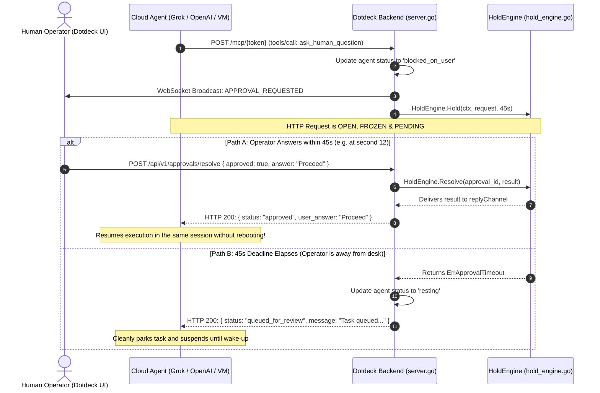

# The 45-Second Synchronous Hold Channel & Human Authority Gating

This document details the architectural purpose, internal mechanics, and execution lifecycles of Dotdeck's **45-Second Synchronous Hold Channel** (`HoldEngine`).

---

## 1. Executive Summary

> [!IMPORTANT]
> The **45-second hold** is Dotdeck's inline bridge between **closed cloud agents** (which execute in isolated cloud VMs) and **human workspace operators**.
> 
> When an agent encounters an action requiring operator sign-off (e.g. paying an invoice, deleting records, or sending client emails), it invokes the `ask_human_question` MCP tool. Instead of immediately returning or dropping the connection, **Dotdeck freezes the HTTP request in a 45-second Go channel**.

- **If the operator answers within 45s**: The tool call returns immediately with `{ "status": "approved", "user_answer": "..." }`. The agent resumes execution in the exact same turn with **zero loss of working memory**.
- **If the operator is away (45s elapses)**: Dotdeck gracefully returns `{ "status": "queued_for_review" }`. The agent cleanly parks its task and goes to sleep without crashing, waiting for an asynchronous wake-up bridge.

---

## 2. Why 45 Seconds Specifically? (The "Goldilocks" Number)

To orchestrate Tier 3 closed cloud agents (xAI Grok Bots, OpenAI Dots, Anthropic Claude, Meta Muse VMs), Dotdeck must operate within the strict networking constraints of cloud providers and reverse proxies:

```
0s ──────────────────────── 45s ────────────────── 60s ────────────────── 100s
▲                           ▲                     ▲                       ▲
Agent calls                 Dotdeck Clean         Cloudflare / LLM        Reverse Proxy
ask_human_question          Timeout Deadline      Gateway Timeout Limit   Hard Drop
(Connection Frozen)         (Graceful Park)       (Fatal 504 Crash)
```

### The Cloud Gateway Timeout Problem
1. **Public Tunnel & Proxy Timeouts**: Cloudflare Free/Pro Tunnels, AWS ALBs, and standard NGINX ingress proxies terminate idle HTTP connections after **60 to 100 seconds**.
2. **LLM Provider Tool-Call Timeouts**: Cloud agents running on OpenAI, xAI, or Anthropic infrastructure enforce client-side HTTP timeouts on tool execution (typically **60 to 90 seconds**).
3. **The 504 Crash Penalty**: If Dotdeck holds an HTTP connection for 65+ seconds, the upstream proxy or client drops the socket with an unrecoverable `504 Gateway Timeout`. When this happens, the LLM agent's cloud runtime throws a fatal exception, killing the entire background task loop and discarding its memory context.

### The Timing Trade-off

| Duration | Classification | Operational Impact |
| :--- | :--- | :--- |
| **10 – 15 Seconds** | **Too Short** | Human operators do not have adequate time to read the agent's question, inspect the reasoning trace, and make an informed decision. Almost every request would fail over to the offline queue. |
| **60 – 120 Seconds** | **Too Long** | Violates upstream gateway ceilings. Cloudflare, corporate VPNs, and LLM tool clients terminate with `504 Gateway Timeout`, terminating the agent run with fatal network exceptions. |
| **45 Seconds** | **The Goldilocks Zone** | **Optimal**: Gives an active human plenty of time (45.0s) to read and respond, while maintaining a **15-second safety buffer** before cloud gateways drop the connection. |

---

## 3. End-to-End Sequence Diagram



---

## 4. Internal Engine Mechanics (`hold_engine.go`)

The core holding mechanism is implemented in [`backend/internal/mcp/hold_engine.go`](file:///C:/GithubProjects/Dotdeck/backend/internal/mcp/hold_engine.go).

### A. Channel-Based Goroutine Freezing
When `Hold()` is called:
1. It creates an internal buffered Go channel: `replyChannel := make(chan DecisionResult, 1)`.
2. Registers the pending request in a thread-safe mutex map: `pendingMap[request.ID]`.
3. Enters a multiplexed `select` block:
   ```go
   select {
   case outcome := <-replyChannel:
       return &outcome, nil
   case <-time.After(timeout): // Exactly 45 seconds
       return nil, ErrApprovalTimeout
   case <-streamContext.Done(): // Client disconnected / cancelled
       return nil, streamContext.Err()
   }
   ```

### B. Distributed Multi-Node Resolution (Redis Pub/Sub)
In multi-node production clusters where the agent's MCP HTTP connection is held on **Switchboard Node A**, but the operator's browser WebSocket is connected to **Switchboard Node B**:
1. When Node B receives the approval resolution, it checks `engine.pendingMap[approvalID]`.
2. Because the channel is not local to Node B, the `HoldEngine` delegates to the `ResolutionPublisher` ([`redis_adapter.go`](file:///C:/GithubProjects/Dotdeck/backend/internal/mcp/redis_adapter.go)).
3. Redis broadcasts the resolution across the cluster mesh, delivering the verdict directly to Node A's `replyChannel` within milliseconds.

### C. Multi-Operator Claim Locking
To prevent two human operators from answering the same question simultaneously, Dotdeck enforces distributed claim locks:
- When an operator focuses the answer field in the UI, the frontend dispatches `POST /api/v1/approvals/claim`.
- The `HoldEngine` marks the slot as `claimedBy = operatorID`.
- WebSocket broadcasts `QUESTION_LOCKED` to all other operators, greying out the input to prevent race conditions.
- If the operator blurs the input or leaves the workspace, `QUESTION_UNLOCKED` is automatically broadcast.

---

## 5. UI Cockpit Experience

In the Dotdeck React Cockpit:

1. **Canvas Node Glow**:
   - The agent node instantly shifts to `blocked_on_user` with an amber warning badge:
     ```text
     [!] Operator Sign-off Required (45s Channel)
     Cloud agent paused on high-stakes tool execution. Click to open review drawer.
     ```
2. **Radial 45.0s SVG Countdown Clock**:
   - Inside [`ApprovalBox.tsx`](file:///C:/GithubProjects/Dotdeck/frontend/src/components/inspector/ApprovalBox.tsx), a high-frequency SVG countdown circle counts down from `45.0s` to `0.0s` in 100ms ticks.
3. **One-Click Tactical Actions**:
   - Operators can click **[Approve]**, **[Reject]**, choose from agent-suggested options, or type custom constraint text (e.g. *"Only email the CEO, do not email other staff"*).

---

## 6. Architecture Comparison

| Architectural Pattern | Agent Turn Termination | Operator Latency | Risk of 504 Gateway Drop | Memory Context Retention |
| :--- | :--- | :--- | :--- | :--- |
| **Traditional Polling Queue** | Yes (Agent terminates turn) | High (minutes to hours) | Low | Low (requires re-prompting) |
| **Indefinite HTTP Hang (>120s)** | No | Low | **Critical (100% fail on cloud)** | None (Crashes on drop) |
| **Dotdeck 45s Hold Channel** | **No** (<45s) / **Yes** (>45s) | **Near-zero (<5s typical)** | **Zero (pre-empts timeout)** | **100% retained inline** |

---

## 7. Relevant Code References

- **Go Hold Engine**: [`backend/internal/mcp/hold_engine.go`](file:///C:/GithubProjects/Dotdeck/backend/internal/mcp/hold_engine.go)
- **MCP Tool Switchboard**: [`backend/internal/mcp/server.go`](file:///C:/GithubProjects/Dotdeck/backend/internal/mcp/server.go#L428-L500)
- **Redis Mesh Adapter**: [`backend/internal/mcp/redis_adapter.go`](file:///C:/GithubProjects/Dotdeck/backend/internal/mcp/redis_adapter.go)
- **Frontend Approval Box**: [`frontend/src/components/inspector/ApprovalBox.tsx`](file:///C:/GithubProjects/Dotdeck/frontend/src/components/inspector/ApprovalBox.tsx)
- **Architecture Decision Record**: [`docs/decisions/0002-mcp-and-held-approval-channels.md`](file:///C:/GithubProjects/Dotdeck/docs/decisions/0002-mcp-and-held-approval-channels.md)
