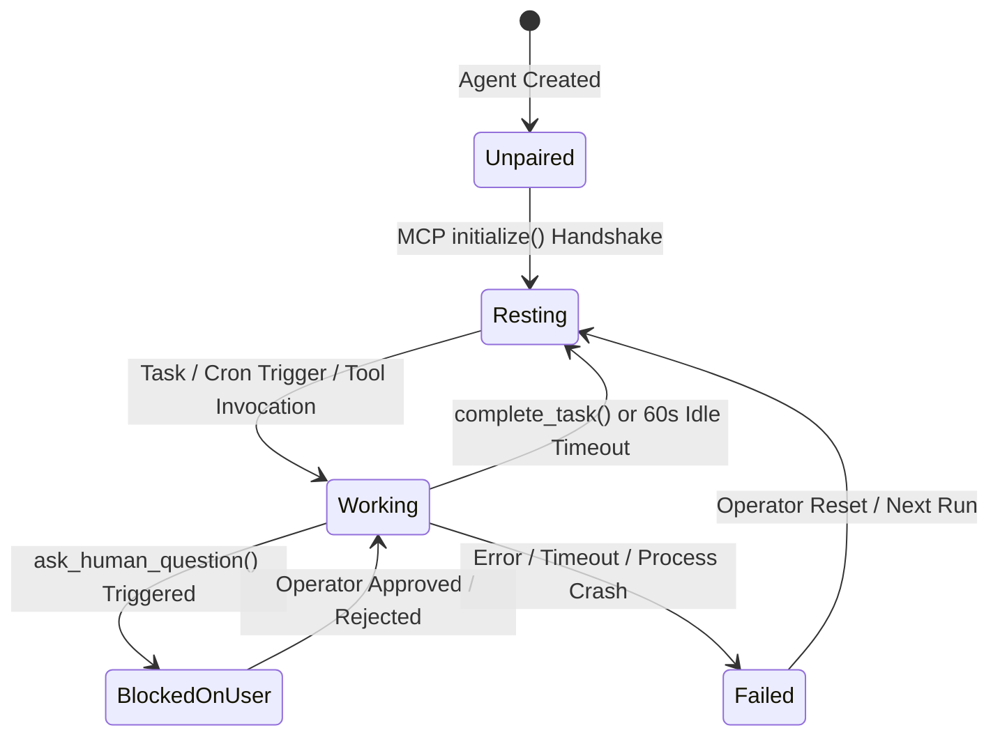

# Dotdeck: The Complete Platform Guide, Architecture, and Enterprise Use Cases

> **The Unified Command Hub & Cross-Vendor Orchestration Switchboard for Tier 3 Closed Cloud AI Agents**  
> *Orchestrate, inspect, govern, and visually interconnect OpenAI Dots, xAI Grok Bots, Meta Muse VMs, and Anthropic Claude Cloud Agents on an infinite real-time multiplayer canvas.*

---

## Table of Contents
1. [Executive Overview & Platform Identity](#1-executive-overview--platform-identity)
2. [The Problem Space: Why Think of Using Dotdeck?](#2-the-problem-space-why-think-of-using-dotdeck)
3. [What Operators Were NOT Able to Do (And Dotdeck Makes Possible)](#3-what-operators-were-not-able-to-do-and-dotdeck-makes-possible)
4. [What Dotdeck Offers Exactly: Architecture & Capabilities](#4-what-dotdeck-offers-exactly-architecture--capabilities)
   - [4.1 The Dynamic MCP Switchboard](#41-the-dynamic-mcp-switchboard)
   - [4.2 The Infinite Multi-Agent Switchboard Canvas](#42-the-infinite-multi-agent-switchboard-canvas)
   - [4.3 The Living Node State Machine](#43-the-living-node-state-machine)
   - [4.4 Unified Thought Stream & Chronological Run Telemetry](#44-unified-thought-stream--chronological-run-telemetry)
   - [4.5 Canvas Deliverable Summaries](#45-canvas-deliverable-summaries)
   - [4.6 The 45-Second Synchronous Hold Engine](#46-the-45-second-synchronous-hold-engine)
   - [4.7 Auto-Resting & 60-Second Inactivity Engine](#47-auto-resting--60-second-inactivity-engine)
   - [4.8 Dynamic Visual Wire Synthesis](#48-dynamic-visual-wire-synthesis)
   - [4.9 Asynchronous Outbound Wake-Up Bridges](#49-asynchronous-outbound-wake-up-bridges)
   - [4.10 Multiplayer Presence, Anti-Collision Locking & RBAC](#410-multiplayer-presence-anti-collision-locking--rbac)
5. [How to Use Dotdeck: Step-by-Step Operator Journey](#5-how-to-use-dotdeck-step-by-step-operator-journey)
6. [Exhaustive Real-World Enterprise Use Cases](#6-exhaustive-real-world-enterprise-use-cases)
   - [Use Case 1: Autonomous Inbound Email Urgency Triaging & Human-Gated Delivery](#use-case-1-autonomous-inbound-email-urgency-triaging--human-gated-delivery)
   - [Use Case 2: Multi-Vendor Lead Enrichment & Compliance Outreach Pipeline](#use-case-2-multi-vendor-lead-enrichment--compliance-outreach-pipeline)
   - [Use Case 3: Autonomous SecOps Infrastructure Reconnaissance & CVE Patch Auditing](#use-case-3-autonomous-secops-infrastructure-reconnaissance--cve-patch-auditing)
   - [Use Case 4: E-Commerce High-Risk Refund Auditing & Fraud Prevention](#use-case-4-e-commerce-high-risk-refund-auditing--fraud-prevention)
   - [Use Case 5: 24/7 DevOps Incident Escalation & Controlled Server Remediation](#use-case-5-247-devops-incident-escalation--controlled-server-remediation)
   - [Use Case 6: Cross-Model Market Intelligence & Content Generation Pipeline](#use-case-6-cross-model-market-intelligence--content-generation-pipeline)
   - [Use Case 7: Legal Contract Review & Multi-Tier Signing Authority](#use-case-7-legal-contract-review--multi-tier-signing-authority)
   - [Use Case 8: Financial Portfolio Rebalancing & Trade Guardrails](#use-case-8-financial-portfolio-rebalancing--trade-guardrails)
7. [Security, Governance & Perimeter Guarantees](#7-security-governance--perimeter-guarantees)
8. [Summary & Next Steps](#8-summary--next-steps)

---

## 1. Executive Overview & Platform Identity

### What is Dotdeck?
**Dotdeck** is an enterprise-grade, vendor-neutral orchestration platform and command cockpit designed specifically for **Tier 3 closed cloud agents**:
- **OpenAI Dots & Custom GPTs** executing within OpenAI's Cloud Computer
- **xAI Grok Bots** operating in xAI Cloud Compute
- **Meta Muse Agents** running inside Muse Secure VMs
- **Anthropic Claude Cloud Agents** deliberating in Anthropic Cloud Projects

Unlike local coding assistants (which run directly on an engineer's laptop with local terminal access), Tier 3 cloud agents operate entirely within proprietary vendor data centers. They execute background schedules, monitor third-party SaaS services (Gmail, Salesforce, Datadog, GitHub), and run autonomous reasoning loops without an active browser tab.

Dotdeck serves as the **tactical flight control switchboard** that brings these isolated cloud agents into a single unified workspace. Through a high-performance Go backend and a real-time React Flow visual canvas, Dotdeck gives engineering teams, operations leads, and security officers complete visibility, interactive human-in-the-loop governance, and cross-vendor delegation capabilities.

---

## 2. The Problem Space: Why Think of Using Dotdeck?

As companies adopt autonomous AI agents across different cloud ecosystems, they inevitably collide with four catastrophic operational bottlenecks:

### 1. The "Walled Garden" Fragmentation Crisis
Every AI provider wants enterprises locked into their proprietary console. An operations team running a sales intelligence workflow might use an OpenAI Dot for web scraping, a Grok Bot for real-time market sentiment, and Claude for strict compliance checking.
- **Without Dotdeck**: Operators must juggle multiple browser windows, separate vendor login accounts, disconnected chat histories, and unstandardized notification streams. There is zero central management.

### 2. The "Black Box" Execution Trap
Tier 3 closed cloud agents run autonomously inside remote cloud sandboxes. You cannot SSH into them, you cannot attach a local debugger, and you cannot view their intermediate deliberation tokens.
- **Without Dotdeck**: You only see the agent's final text message when it finishes—or when it silently crashes. You have zero insight into *why* an agent made a decision, what intermediate steps it took, or what tool arguments it passed.

### 3. The Ungoverned Autonomous Action Danger
Organizations are connecting cloud agents to live corporate systems: Gmail inboxes, production databases, Stripe billing APIs, AWS infrastructure, and CRM records.
- **Without Dotdeck**: Once an autonomous cron automation triggers, the agent runs wild. If a model hallucinates or misinterprets an email, it executes irreversible API deletions, sends unauthorized client communications, or issues unauthorized refunds before anyone can intervene.

### 4. Zero Inter-Agent Interoperability
OpenAI Dots cannot talk to xAI Grok Bots. Grok Bots cannot hand off structured tasks to Claude Agents. 
- **Without Dotdeck**: Multi-agent pipelines are impossible without engineering teams writing, deploying, and maintaining custom REST microservices, token authenticators, webhook parsers, and retry queues for every vendor combination.

---

## 3. What Operators Were NOT Able to Do (And Dotdeck Makes Possible)

| Operational Capability | Before Dotdeck (Status Quo) | With Dotdeck (Unified Switchboard) |
| :--- | :--- | :--- |
| **Cross-Vendor Observability** | ❌ **Impossible**. Isolated vendor dashboards with incompatible telemetry and no shared flight deck. | ✅ **Single Infinite Canvas**. All cloud agents (OpenAI, Grok, Meta, Claude) displayed as interactive living nodes in real time. |
| **Live Chain-of-Thought Inspection** | ❌ **Impossible**. Vendor sandboxes hide intermediate reasoning steps until the full run completes. | ✅ **Unified Thought Stream**. Stream live analytical milestones and planned next steps into a centralized feed organized by execution runs. |
| **Synchronous Human Authorization** | ❌ **Impossible**. No vendor provides a synchronous pause mechanism during tool execution. | ✅ **45-Second Hold Engine**. `ask_human_question` synchronously pauses the remote cloud VM while waiting for an operator sign-off. |
| **Visual Multi-Agent Wiring** | ❌ **Impossible**. Requires writing custom backend glue code, auth tokens, and polling workers. | ✅ **Drag-and-Drop Wire Synthesis**. Dragging a wire between two nodes dynamically synthesizes an MCP delegation tool into the source agent's schema. |
| **Deliverable Output Tracking** | ❌ **Scattered**. Deliverables buried inside long chat logs across multiple platforms. | ✅ **Canvas Deliverable Cards**. Resting nodes showcase their latest executive summaries and deliverable outputs right on their canvas card. |
| **Idle & Execution Run Tracking** | ❌ **Uncertain**. Operators cannot tell if an agent is currently thinking, resting, or hung. | ✅ **60s Auto-Resting & Run Indexing**. Distinguish active runs from idle standby, tracking chronological runs (Run #1 to Latest Run). |
| **Team Anti-Collision Oversight** | ❌ **Chaotic**. Multiple operators open the same chat console and duplicate responses or fight for control. | ✅ **Multiplayer Presence & Locks**. Live collaborator cursors, presence avatars, and optimistic question locking prevent duplicate approvals. |

---

## 4. What Dotdeck Offers Exactly: Architecture & Capabilities

```
 ┌──────────────────────┐   ┌──────────────────────┐   ┌──────────────────────┐   ┌──────────────────────┐
 │      OpenAI Dot      │   │    xAI Grok Bot      │   │    Meta Muse VM      │   │  Claude Cloud Agent  │
 │   (Cloud Computer)   │   │  (xAI Cloud Compute) │   │  (Muse Secure VM)    │   │   (Anthropic Cloud)  │
 └──────────┬───────────┘   └──────────┬───────────┘   └──────────┬───────────┘   └──────────┬───────────┘
            │                          │                          │                          │
            └──────────────────────────┼──────────────────────────┴──────────────────────────┘
                                       ▼ (Model Context Protocol / SSE / JSON-RPC 2.0)
 ┌───────────────────────────────────────────────────────────────────────────────────────────────────┐
 │                                   DOTDECK SWITCHBOARD (GO BACKEND)                                │
 │                                                                                                   │
 │  ┌─────────────────────────┐  ┌─────────────────────────┐  ┌───────────────────────────────────┐  │
 │  │   MCP Endpoint Router   │  │   Dynamic Edge Router   │  │     45s Synchronous Hold Engine   │  │
 │  │  (/mcp/{agent_token})   │  │ (Tool Schema Synthesis) │  │   (ask_human_question Dispatcher) │  │
 │  └────────────┬────────────┘  └────────────┬────────────┘  └─────────────────┬─────────────────┘  │
 │               │                            │                                 │                    │
 │               └────────────────────────────┼─────────────────────────────────┘                    │
 │                                            ▼                                                      │
 │                             High-Performance Event Broadcaster                                    │
 │                               (WebSockets + In-Memory Store)                                      │
 └────────────────────────────────────────────┬──────────────────────────────────────────────────────┘
                                              │ (Real-Time WebSocket Streams)
                                              ▼
 ┌───────────────────────────────────────────────────────────────────────────────────────────────────┐
 │                                 DOTDECK COCKPIT (REACT FLOW CANVAS)                               │
 │                                                                                                   │
 │  • Living Node State Engine [Unpaired | Resting | Scheduled | Working | Needs Authority | Failed] │
 │  • Slide-Out Inspector Drawer: Live Thought Stream Virtualizer + Run Filter (Run #1..Latest)      │
 │  • Dynamic Deliverable Box: Instant canvas visibility into final outputs                          │
 │  • Interactive Edge Wiring with animated pulsating packet visualization                           │
 │  • Multiplayer Collaboration: Live teammate cursors, presence avatars & question locks            │
 └───────────────────────────────────────────────────────────────────────────────────────────────────┘
```

---

### 4.1 The Dynamic MCP Switchboard
Dotdeck implements a full-featured, zero-install **Model Context Protocol (MCP)** server on its Go backend (`/mcp/{agent_token}`).
- **Standard Protocol Compliance**: Implements MCP Specification 2024-11-05, including `initialize`, `notifications/initialized`, `ping`, `tools/list`, `tools/call`, `resources/list`, and `prompts/list`.
- **Zero Local Footprint**: Closed cloud agents connect directly over HTTPS/SSE via secure Cloudflare or custom domain tunnels. You do not need to install local CLI daemons or docker sidecars.
- **Automated Bootstrap Directives**: Provisioning an agent generates a tailored system directive that instructs the cloud agent on how to use Dotdeck's governance and telemetry tools.

---

### 4.2 The Infinite Multi-Agent Switchboard Canvas
Built on `@xyflow/react` (React Flow), Dotdeck provides a high-performance visual command deck:
- **Spatial Topology**: Organize agents logically into departments, tiers, or pipelines.
- **Non-Intrusive Viewport**: Camera centering is strictly reserved for new agent creation and onboarding; operators can pan, zoom, click, inspect, and drag nodes freely without the canvas camera fighting back.
- **Hardware Port Visuals**: Custom nodes feature 4 connection handles (Top, Right, Bottom, Left) styled like physical hardware switchboard jacks with generous hit zones.
- **Auto-Layout Switchboard**: A dedicated auto-organize engine recalculates topological layers with a single click.

---

### 4.3 The Living Node State Machine
Every agent card dynamically reflects its exact operational state:



- **Unpaired** *(Dashed Border)*: Awaiting remote cloud MCP connection handshake.
- **Resting** *(Neutral Slate)*: Idle in vendor cloud, standing by for its next trigger. Displays the **latest deliverable output**.
- **Scheduled** *(Blue Badge)*: Waiting for its next cron execution window.
- **Working** *(Emerald Pulsing Shadow)*: Actively reasoning, fetching data, or invoking external tools.
- **Needs Authority** *(Amber Warning Halo)*: Suspended inside Dotdeck's 45-second hold engine awaiting human operator sign-off.
- **Terminated / Failed** *(Rose Border)*: Execution error or unhandled exception.

---

### 4.4 Unified Thought Stream & Chronological Run Telemetry
When cloud agents deliberate, they call Dotdeck's `report_thought_step(reasoning_trace, next_planned_step)`.
- **Execution Run Numbering**: Thoughts are grouped chronologically by execution runs. The oldest execution is marked as **Run #1**, subsequent runs as **Run #2**, and the active run is clearly labeled as **Run #N (Latest Run)**.
- **Deduplication Engine**: Dotdeck automatically discards redundant telemetry chatter, echoing confirmations, or duplicate timestamps, keeping the stream high-signal and executive-ready.
- **Run Selector**: Operators can quickly jump between past historical runs and the latest run to audit deductions step-by-step.

---

### 4.5 Canvas Deliverable Summaries
When an agent finishes its task, it calls `complete_task(summary)`.
- **Direct Canvas Card Visibility**: When the agent transitions to **Resting**, an emerald deliverable banner appears directly on the agent's canvas node showing a concise 1-2 sentence executive summary of what was concluded or delivered.
- **Zero Context Switching**: Operators scanning the switchboard can see what each agent produced without having to open drawers or read chat logs.

---

### 4.6 The 45-Second Synchronous Hold Engine
When an agent encounters a high-risk decision or reaches an authority boundary, it calls `ask_human_question(question, reasoning_trace)`.
- **Synchronous Pausing**: The Go backend holds the HTTP/SSE connection open for up to 45 seconds, effectively pausing the cloud agent's reasoning loop mid-thought.
- **Interactive Approval Card**: An urgent amber beacon lights up on the canvas node, and an approval card appears in the Inspector Drawer showing the agent's question, reasoning context, and interactive choices.
- **Operator Authority**: When an operator clicks **Approve** or enters a custom decision, Dotdeck unblocks the connection and returns `{"status": "approved", "user_answer": "..."}` directly to the agent's tool call.
- **Timeout Protection**: If the 45-second window expires without operator input, the tool safely fails with an authority timeout, preventing unauthorized execution.

---

### 4.7 Auto-Resting & 60-Second Inactivity Engine
In chat-based or automation-based closed agents (like Grok Automations or OpenAI Custom GPTs), agents don't explicitly terminate connections after outputting a message.
- **Inactivity Sentinel**: If an agent stops emitting thoughts or invoking tools for 60 consecutive seconds, Dotdeck's background sentinel automatically transitions the agent from **Working** to **Resting**.
- **Accurate Fleet Status**: Ensures your command deck always reflects reality rather than leaving agents perpetually stuck in "Working" status.

---

### 4.8 Dynamic Visual Wire Synthesis
Connecting two agents on the canvas is not just a cosmetic diagram—it creates a real, functional software bridge:
- **Instant Tool Synthesis**: Dragging a connection wire from `Sales Research Dot (OpenAI)` to `Grok Copywriter (xAI)` instantly generates a new MCP tool in the source agent's schema: `delegate_task_to_grok_copywriter`.
- **Automatic Execution**: When the source agent calls this tool with a JSON payload, Dotdeck validates the transmission, flashes an animated glowing packet across the wire (`pulseEdge`), and queues the payload for the target agent.
- **Reversible & Modifiable**: Reconnecting handles or deleting wires immediately updates the active MCP schemas in real time.

---

### 4.9 Asynchronous Outbound Wake-Up Bridges
When an agent is resting in the vendor cloud, Dotdeck can wake it up and pass instructions via configured outbound bridges:
- **Slack Threads**: Directs messages into dedicated agent Slack channels with deep links.
- **HMAC-Signed Webhooks**: Dispatches secure POST payloads to external serverless functions or vendor orchestration endpoints.
- **Direct Cloud Computer Triggers**: Wakes dormant sandboxes with structured input payloads.

---

### 4.10 Multiplayer Presence, Anti-Collision Locking & RBAC
Dotdeck is built from the ground up for collaborative team operations:
- **Multiplayer Cursors**: See where your teammates are pointing, inspecting, and navigating across the canvas in real time.
- **Optimistic Question Locking**: When an operator begins reviewing a pending approval, Dotdeck locks the card with their avatar, preventing accidental duplicate approvals from teammates.
- **Role-Based Access Control (RBAC)**:
  - **Admin**: Full control over agent provisioning, wire connections, and workspace settings.
  - **Write**: Can steer agents, approve holds, and modify canvas layouts.
  - **Read (Showcase Mode)**: Observer access for executives, auditors, and external stakeholders with editing disabled.

---

## 5. How to Use Dotdeck: Step-by-Step Operator Journey

```
  [ STEP 1 ]               [ STEP 2 ]               [ STEP 3 ]               [ STEP 4 ]               [ STEP 5 ]
Create Workspace ────► Provision Agent ────► Pair MCP Directives ────► Wire Topology ────► Flight Control
  (Fleet Hub)            (Select Model)        (Paste in Vendor)       (Drag & Drop)      (Thoughts & Approvals)
```

### Step 1: Create a Fleet Workspace
1. In the Dotdeck Cockpit, open the **Fleet Hub** (`/dashboard`).
2. Click **Create Fleet** and enter a name (e.g. `Revenue Operations Swarm` or `SecOps Vulnerability Fleet`).
3. Click **Enter Cockpit** to open your dedicated switchboard canvas.

### Step 2: Provision Agent Nodes
1. Click **Add Agent** in the top navigation bar.
2. Select your AI Provider:
   - **OpenAI Dot**: Tier 3 OpenAI cloud computer with autonomous tool execution.
   - **xAI Grok Bot**: Real-time cloud reasoning with web/computer tools.
   - **Meta Muse**: Secure VM agent with webhook check-in fallback.
   - **Claude Cloud**: Anthropic cloud agent with high reasoning density.
3. Configure the agent's **Name**, **Ongoing Goal**, and **Authority Boundaries** (e.g. *Require human approval before modifying production data*).
4. Click **Provision & Connect MCP**.

### Step 3: Pair the Agent with Vendor Cloud
1. Dotdeck immediately generates a dedicated MCP endpoint (`https://.../mcp/{agent_token}`) and a formatted **Bootstrap Directive**.
2. Copy the directive and paste it into your vendor's configuration screen:
   - *OpenAI*: Paste into your Custom GPT or Dot **Instructions** field.
   - *xAI Grok*: Paste into your Grok Cloud Computer system directive panel.
   - *Claude*: Paste into your Claude Project or Agent prompt.
   - *Meta Muse*: Paste into your Muse VM agent configuration.
3. The 3-Step Pairing Wizard automatically listens for the agent's `initialize()` handshake.
4. Once detected, a green **Heartbeat Handshake Confirmed** checkmark appears. Click **View on Canvas**.

### Step 4: Wire Canvas Topology
1. Click and drag from any of the source agent's connection ports (Right, Bottom, etc.) to a target agent's port.
2. Dotdeck instantly synthesizes a `delegate_task_to_{target_name}` tool into the source agent's MCP schema.
3. Your cross-vendor multi-agent pipeline is now live and functional.

### Step 5: Live Flight Control & Human-in-the-Loop Governance
1. Click any agent node to slide out the **Inspector Drawer**.
2. Watch the **Thought Stream** update in real time as the agent breaks down its task into deduction steps.
3. If an agent triggers an authority boundary, an amber card appears in your **Pending Decision Queue**. Review the agent's reasoning, click **Approve** or **Reject**, and watch the agent resume execution.
4. When finished, review the deliverable summary directly on the agent's resting canvas card.

---

## 6. Exhaustive Real-World Enterprise Use Cases

---

### Use Case 1: Autonomous Inbound Email Urgency Triaging & Human-Gated Delivery
* **Primary Agent**: xAI Grok Bot
* **External Connectors**: Gmail / Outlook Connector + Dotdeck Switchboard
* **Authority Rule**: *Require operator sign-off before dispatching external summaries or executing replies to urgent client emails.*

#### The Challenge
Autonomous email triaging bots often hallucinate urgency, miss executive context, or trigger embarrassing automated replies to key enterprise clients.

#### The Dotdeck Solution
```
 [ Gmail Inbox ]
       │ (Poll unread messages)
       ▼
 ┌───────────────┐  report_thought_step()   ┌────────────────────────┐
 │   Grok Bot    │ ───────────────────────► │ Thought Stream Ticker  │
 └───────┬───────┘                          └────────────────────────┘
         │
         │ (Urgent VIP email detected: Severity 1)
         ▼ ask_human_question(question, reasoning_trace)
 ┌──────────────────────────────────────────────────────────────────┐
 │ DOTDECK 45s HOLD ENGINE: "Is this email summary satisfactory?"   │
 │ [Operator Reviews & Approves: "Deliver with high-priority flag"] │
 └───────────────────────────────┬──────────────────────────────────┘
                                 │
                                 ▼ complete_task(summary)
                   ┌───────────────────────────┐
                   │ Canvas Deliverable Card   │
                   │ Status: Resting           │
                   └───────────────────────────┘
```
1. **Detection**: Grok Bot polls Gmail, finds an unread message from a prospective enterprise client or security escalation.
2. **Telemetry**: Grok calls `report_thought_step("Analyzing incoming email from enterprise prospect; assessing urgency.", "Extract key action items")`. The Dotdeck canvas shows Grok in **Working** state.
3. **Authority Checkpoint**: Recognizing an urgent context, Grok invokes `ask_human_question("Is this email summary satisfactory to deliver?", "Summarized candidate inquiry into 4 bullet points")`.
4. **Synchronous Hold**: Grok pauses in its cloud compute VM for up to 45 seconds. The Dotdeck node glows amber (**Needs Authority**).
5. **Operator Sign-Off**: The human operator clicks **Approve**. Grok receives the approval, delivers the summary, and calls `complete_task("Delivered executive briefing for enterprise lead to inbox.")`.
6. **Result**: Zero unauthorized client communications, full transparency, and verifiable human sign-off.

---

### Use Case 2: Multi-Vendor Lead Enrichment & Compliance Outreach Pipeline
* **Source Agent**: OpenAI Sales Research Dot
* **Middle Agent**: xAI Grok Copywriter
* **Auditing Agent**: Anthropic Claude Compliance Specialist
* **Topology**: `OpenAI Dot ──► Grok Copywriter ──► Claude Compliance`

#### The Challenge
Sales automation requires web scraping, creative copywriting, and strict GDPR/privacy legal adherence. No single model excels at all three, and passing data between them manually is an operational nightmare.

#### The Dotdeck Solution
1. **Web Research (OpenAI Dot)**: Researches high-intent B2B accounts, scans corporate tech stacks, and summarizes business models.
2. **Dynamic Delegation**: OpenAI Dot invokes `delegate_task_to_grok_copywriter(payload)`. An animated packet pulses along the canvas wire to Grok.
3. **Bespoke Copy (xAI Grok)**: Grok ingests the technical dossier and writes personalized outbound cold outreach variants. Grok calls `delegate_task_to_claude_compliance(copy_variants)`.
4. **GDPR Audit (Claude)**: Claude audits the copy against CAN-SPAM and GDPR guidelines. If personal identifiable data or aggressive claims are found, Claude pauses in Dotdeck's **45s Hold Engine** asking the sales director for approval.
5. **Result**: A production multi-agent pipeline spanning three competing AI vendors operating with military-grade compliance.

---

### Use Case 3: Autonomous SecOps Infrastructure Reconnaissance & CVE Patch Auditing
* **Recon Agent**: Meta Muse Recon Agent (Secure VM)
* **Auditing Agent**: Anthropic Claude Infrastructure Auditor
* **Authority Rule**: *Require human sign-off before modifying firewall rules, revoking IAM certificates, or redeploying cloud containers.*

#### The Challenge
Autonomous security agents can discover vulnerabilities quickly, but allowing an AI to autonomously alter production firewall rules or terminate servers can trigger catastrophic outages.

#### The Dotdeck Solution
1. **Port & CIDR Scanning**: Meta Muse continuously scans corporate cloud perimeters and flags unpatched CVE vulnerabilities.
2. **Analysis Hand-Off**: Meta Muse delegates the vulnerability report to Claude Auditor via Dotdeck's synthesized wire.
3. **Patch Verification**: Claude designs an infrastructure remediation patch and checks for backward compatibility.
4. **Human Gate**: Claude invokes `ask_human_question("Approve Terraform patch to close port 8443 on AWS cluster?", reasoning_trace)`.
5. **SecOps Sign-Off**: On-call SecOps engineers inspect the proposed diff in Dotdeck's Inspector, verify safety, and click **Authorize**.
6. **Result**: Rapid security incident remediation without the risk of autonomous self-inflicted outages.

---

### Use Case 4: E-Commerce High-Risk Refund Auditing & Fraud Prevention
* **Primary Agent**: Claude Escalation Specialist
* **External Systems**: Shopify API, Stripe Billing, Zendesk
* **Authority Rule**: *Require human verification for financial transactions or refund payouts exceeding $500.*

#### The Challenge
Customer service AI bots frequently get tricked by social engineering or policy exploits, issuing unauthorized refunds and costing retailers millions.

#### The Dotdeck Solution
1. **Customer Dispute Ingestion**: Claude ingests customer refund requests and shipping tracking information.
2. **Automated Triage**: For claims under $50, Claude approves standard returns automatically and logs thought steps.
3. **High-Value Threshold**: A refund request arrives for $1,250 on a damaged luxury item. Claude detects the $500 threshold violation.
4. **Hold Engine Pausing**: Claude invokes `ask_human_question("Payout exceeds $500 threshold ($1,250). Review customer photo evidence and authorize refund?", reasoning)`.
5. **Operator Intervention**: A customer support manager reviews the damage photos directly within Dotdeck, confirms validity, and clicks **Approve**.
6. **Execution**: Claude executes the Stripe refund and publishes the deliverable confirmation to the canvas.

---

### Use Case 5: 24/7 DevOps Incident Escalation & Controlled Server Remediation
* **Primary Agent**: OpenAI Site Reliability Dot
* **External Systems**: Datadog Webhooks, PagerDuty, AWS ECS
* **Authority Rule**: *Require operator sign-off before restarting production services or executing database rollbacks.*

#### The Challenge
On-call engineers are woken up at 3:00 AM for trivial false alarms, but automated self-healing scripts frequently cause split-brain scenarios or data corruption.

#### The Dotdeck Solution
1. **Incident Trigger**: Datadog triggers an alert on API error rates. Dotdeck's wake-up bridge wakes the SRE Dot.
2. **Root Cause Analysis**: SRE Dot checks container memory logs, correlates metrics, and discovers a memory leak in service worker `auth-v2`.
3. **Controlled Remediation**: SRE Dot drafts a rolling container restart plan and calls `ask_human_question("Restart auth-v2 ECS task across cluster to clear memory leak?", reasoning)`.
4. **On-Call Slack / Cockpit Bridge**: Dotdeck sends an alert notification with an instant approval button. The engineer taps **Approve** from their phone or browser.
5. **Recovery**: The service restarts cleanly; SRE Dot emits `complete_task("auth-v2 memory leak mitigated; cluster error rate returned to 0.01%.")`.

---

### Use Case 6: Cross-Model Market Intelligence & Content Generation Pipeline
* **Agents**: xAI Grok (Real-time X trends) + OpenAI Dot (Editorial synthesis) + Claude (Brand voice adherence)
* **Goal**: Generate high-impact corporate thought-leadership analysis from breaking industry news.

#### The Dotdeck Solution
1. **Real-time Trend Detection**: Grok monitors breaking industry developments and sentiment on social platforms.
2. **Deep Synthesis**: Grok hands off raw data to OpenAI Dot to synthesize an in-depth corporate whitepaper.
3. **Brand Tone & Fact Checking**: Claude reviews the whitepaper for brand tone, citing primary sources.
4. **Canvas Inspection**: Marketing leadership reviews the complete draft in the resting deliverable card and approves publication.

---

### Use Case 7: Legal Contract Review & Multi-Tier Signing Authority
* **Agents**: Claude Legal Specialist + Meta Muse Archive Bot
* **Authority Rule**: *Require general counsel sign-off on any contract containing uncapped indemnity or non-standard governing law.*

#### The Dotdeck Solution
1. **Contract Ingestion**: Ingests incoming 80-page vendor Master Services Agreements (MSAs).
2. **Clause Extraction**: Claude extracts indemnity, liability caps, and termination clauses.
3. **Red Flag Escalation**: Claude identifies an uncapped liability clause and triggers Dotdeck's hold engine.
4. **Counsel Review**: The corporate legal team receives the exact clause comparison in Dotdeck, writes a custom negotiation redline, and passes it back to the agent to draft the response letter.

---

### Use Case 8: Financial Portfolio Rebalancing & Trade Guardrails
* **Agents**: Grok Market Analyzer + Claude Quantitative Risk Officer
* **Authority Rule**: *Require human sign-off for single-asset rebalancing orders exceeding $100,000.*

#### The Dotdeck Solution
1. **Market Scanning**: Grok tracks macroeconomic releases and earnings reports.
2. **Risk Optimization**: Claude calculates optimal portfolio weightings and drafts rebalancing orders.
3. **Capital Gate**: Trades under $10,000 execute automatically; high-value block trades pause in Dotdeck for fund manager sign-off.
4. **Audited Deliverable**: Every approved or rejected trade is permanently recorded in Dotdeck's execution run history.

---

## 7. Security, Governance & Perimeter Guarantees

Dotdeck is built to satisfy strict enterprise security and data privacy requirements:

```
 ┌────────────────────────────────────────────────────────────────────────┐
 │                      ENTERPRISE SECURITY PERIMETER                     │
 │                                                                        │
 │   1. Token-Scoped Isolation:                                           │
 │      Every agent receives a 128-bit cryptographic token. Endpoints     │
 │      are strictly isolated; one agent cannot access another's bus.     │
 │                                                                        │
 │   2. Zero Credential Storage:                                          │
 │      Dotdeck never stores your underlying vendor API keys. Connectors  │
 │      authenticate via standard MCP bearer tokens.                      │
 │                                                                        │
 │   3. Ephemeral In-Memory & Encrypted Persistence:                      │
 │      Thoughts and approvals support both fast in-memory execution      │
 │      and encrypted PostgreSQL storage with strict multi-tenancy.       │
 │                                                                        │
 │   4. Immutable Audit Trail:                                            │
 │      Every thought step, tool call, operator approval, and decision    │
 │      response is timestamped with user IDs for regulatory compliance.  │
 └────────────────────────────────────────────────────────────────────────┘
```

---

## 8. Summary & Next Steps

Dotdeck bridges the critical gap between **isolated cloud AI models** and **controllable, production-grade enterprise teams**. By providing a visual topology canvas, a zero-install MCP switchboard, live chronological thought streams, and a synchronous 45-second human hold engine, Dotdeck empowers teams to deploy autonomous AI agents with absolute confidence.

### Getting Started Checklist
1. **Launch the Web Cockpit**: Open `http://localhost:3000` or your deployed Dotdeck domain.
2. **Explore Default Swarms**: Inspect the pre-configured *Enterprise Outbound Swarm* or *SecOps Vulnerability Fleet*.
3. **Provision Your First Cloud Agent**: Click **Add Agent**, select your provider, copy the bootstrap prompt into your vendor console, and start orchestrating your autonomous AI fleet.
