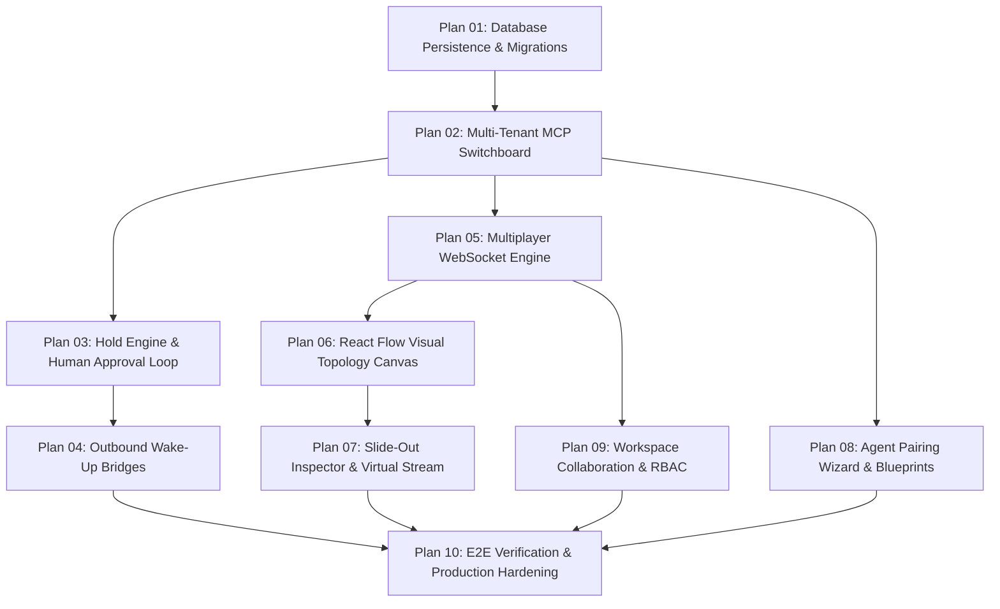

# Dotdeck Engineering Master Execution Plans

This directory contains the sequential, numbered implementation plans for the **Dotdeck** Closed Cloud Agent Switchboard & Visualizer.

All plans strictly follow [.agents/rules/plan-standards.md](file:///C:/GithubProjects/Dotdeck/.agents/rules/plan-standards.md) and define explicit objectives, structured deliverables, and measurable Definitions of Done (DoD).

---

## Plan Roadmap & Execution Sequence

---

## Master Index

| # | Plan File | Focus Area | Status |
| :---: | :--- | :--- | :---: |
| **01** | [plan-01-database-persistence-and-migrations.md](file:///C:/GithubProjects/Dotdeck/plans/plan-01-database-persistence-and-migrations.md) | PostgreSQL schema, monthly range partitioning, pgx pool, sqlc codegen, migration runner | Completed [x] |
| **02** | [plan-02-multi-tenant-mcp-switchboard.md](file:///C:/GithubProjects/Dotdeck/plans/plan-02-multi-tenant-mcp-switchboard.md) | JSON-RPC 2.0 `/mcp/{token}` endpoint, dynamic tool injection | Completed [x] |
| **03** | [plan-03-hold-engine-and-human-approval-loop.md](file:///C:/GithubProjects/Dotdeck/plans/plan-03-hold-engine-and-human-approval-loop.md) | 45s pause-and-answer channels, Redis cross-node resolution mesh, race condition locks | Completed [x] |
| **04** | [plan-04-outbound-wake-up-bridges.md](file:///C:/GithubProjects/Dotdeck/plans/plan-04-outbound-wake-up-bridges.md) | Slack thread wake-up, HMAC-signed webhooks, email triggers | Completed [x] |
| **05** | [plan-05-multiplayer-websocket-engine.md](file:///C:/GithubProjects/Dotdeck/plans/plan-05-multiplayer-websocket-engine.md) | coder/websocket rooms, Redis Pub/Sub cluster fanout, cursor presence, typing indicators | Upcoming `[ ]` |
| **06** | [plan-06-react-flow-visual-topology-canvas.md](file:///C:/GithubProjects/Dotdeck/plans/plan-06-react-flow-visual-topology-canvas.md) | 5 visual states, live thought ticker, animated pulse edges | Upcoming `[ ]` |
| **07** | [plan-07-slide-out-inspector-and-virtual-stream.md](file:///C:/GithubProjects/Dotdeck/plans/plan-07-slide-out-inspector-and-virtual-stream.md) | Slide-out drawer, `@tanstack/react-virtual` log stream | Upcoming `[ ]` |
| **08** | [plan-08-agent-pairing-wizard-and-blueprints.md](file:///C:/GithubProjects/Dotdeck/plans/plan-08-agent-pairing-wizard-and-blueprints.md) | 60s bootstrap prompt generator, heartbeat detector | Upcoming `[ ]` |
| **09** | [plan-09-workspace-collaboration-and-rbac.md](file:///C:/GithubProjects/Dotdeck/plans/plan-09-workspace-collaboration-and-rbac.md) | Multi-tenancy, member roles (Admin/Write/Read), showcase link | Upcoming `[ ]` |
| **10** | [plan-10-end-to-end-verification-and-production-hardening.md](file:///C:/GithubProjects/Dotdeck/plans/plan-10-end-to-end-verification-and-production-hardening.md) | E2E mock agent simulation, Docker Compose validation, tests | Upcoming `[ ]` |

---

## Execution Rules
1. Work through plans **sequentially (01 through 10)**.
2. Mark tasks and plans as `In Progress [x]` while actively working and `Completed [x]` when passing DoD.
3. Always ensure Go Google-Style docstrings and strict naming conventions are preserved.
