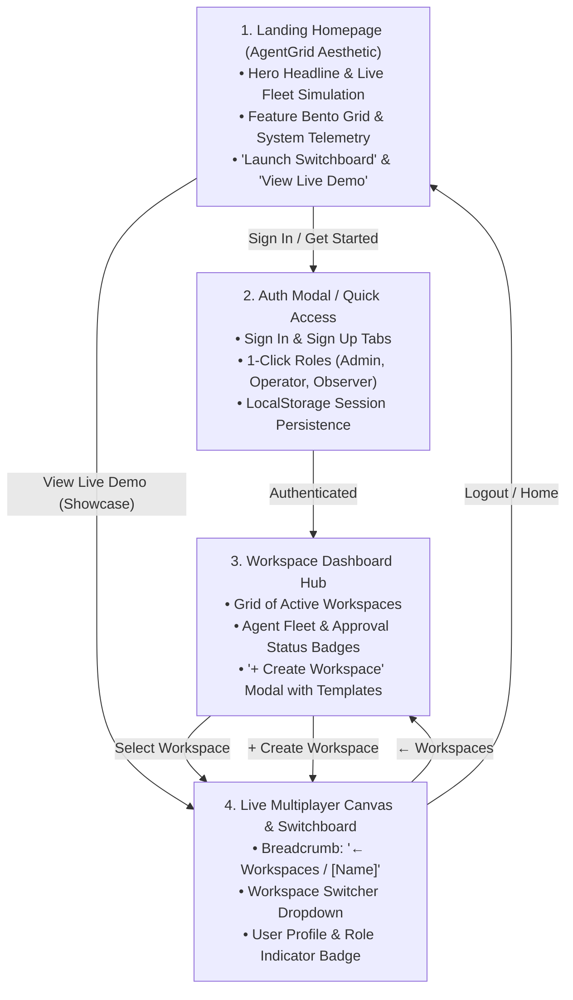

# Plan 11: AgentGrid-Inspired Homepage, Authentication Flow, and Workspace Management Hub

**Status:** Completed [x]

## Objective
Elevate Dotdeck from a standalone canvas view into a complete, production-grade product ecosystem inspired by the sleek, cybernetic, high-contrast dark aesthetic of [agentgrid.io](https://agentgrid.io/). Implement an AgentGrid-inspired landing homepage with live telemetry, a streamlined authentication flow (Sign Up / Sign In with one-click demo roles), an interactive workspace management hub (viewing, searching, and creating new workspaces), and seamless in-app navigation between landing, dashboard, and the live multiplayer canvas.

---

## Strategic Context & Design Direction

### 1. The Design Benchmark: AgentGrid.io Aesthetic
[agentgrid.io](https://agentgrid.io/) (by Anima) provides a shared workspace and collaboration layer for humans and multi-model AI agents ("Google Drive for humans, Git for agents"). Its visual signature features:
- **Deep Void Backgrounds & Ambient Grids:** Pure dark canvases (`#07080B`, `#0D0F17`) layered with subtle radial dot matrices and hairline grid lines.
- **Electric Telemetry Accents:** High-contrast neon cyan (`#06B6D4`), emerald green (`#10B981`), and royal indigo (`#6366F1`) badges indicating live status, latency, and model providers.
- **Bento Card Structure:** Information-dense, glassmorphic cards with hairline borders (`border-white/10`), crisp typography, and purposeful data hierarchy without visual clutter.
- **Instant Human-Agent Ergonomics:** Fast transitions from public marketing into live operational workspaces with zero onboarding friction.

### 2. User Journey Flow

---

## Detailed Deliverables

### Deliverable 1: Design Tokens & AgentGrid Aesthetic Foundation
- [x] Define reusable dark-mode color tokens in Tailwind and CSS:
  - Backgrounds: `#07080B` (app background), `#0D0F17` (surface), `#141824` (card), `#1E2438` (border).
  - Accents: Electric Cyan (`#06B6D4`), Emerald Pulse (`#10B981`), Violet Glow (`#6366F1`), Amber Warning (`#F59E0B`).
- [x] Implement subtle cybernetic grid background patterns (`bg-dot-grid`, `bg-circuit-pattern`).
- [x] Integrate smooth micro-interactions via `framer-motion` (fade reveals, glowing border hovers, active telemetry rings).

### Deliverable 2: AgentGrid-Inspired Landing Homepage (`frontend/src/components/home/LandingPage.tsx`)
- [x] **Header / Navigation:**
  - Dotdeck emblem with active pulsating status dot.
  - Nav links: "Architecture", "Switchboard Specs", "Docs", "GitHub".
  - Actions: "Sign In" button & "Launch Deck" primary CTA.
- [x] **Hero Section:**
  - High-impact headline: *"The Command Hub for Autonomous Cloud Agents"*.
  - Subtitle: *"Vendor-neutral switchboard, 45-second hold engine, and live visual control plane for OpenAI Dots, Grok Bots, Meta Muse, and Claude."*
  - Dual CTAs: *"Enter Workspaces"* (opens Auth/Dashboard) and *"Explore Live Showcase"* (opens public observer canvas).
- [x] **Interactive Fleet Telemetry Preview:**
  - Embedded, interactive live graph preview simulating active agent nodes (OpenAI Lead Researcher -> Grok Copywriter) with flowing pulse edge packets and a real-time thought ticker.
- [x] **Bento Feature Showcase (AgentGrid style):**
  - Card 1: *Multi-Tenant MCP Switchboard* (dynamic `/mcp/{token}` injection).
  - Card 2: *45-Second Hold Engine* (sub-100ms inline human approval resumption).
  - Card 3: *Runaway Loop Guardrails* (automatic token spend and cyclic handoff circuit breakers).
  - Card 4: *Multiplayer Presence & RBAC* (live team cursors, admin/operator/observer permissions).
- [x] **System Status Bar:**
  - Live indicator: *"All Switchboard Systems Operational · 99.98% Uptime · sub-50ms Hold Latency"*.

### Deliverable 3: Authentication System & User Session Store (`frontend/src/store/useAuthStore.ts` & `frontend/src/components/auth/AuthModal.tsx`)
- [x] Create persistent `useAuthStore` using Zustand:
  - User model: `{ id: string, name: string, email: string, avatar: string, role: 'admin' | 'write' | 'read' }`.
  - Persists session in `localStorage` under key `dotdeck_auth`.
  - Actions: `login(email, role)`, `logout()`, `switchRole(role)`.
- [x] Build sleek modal `AuthModal.tsx`:
  - Tabs: "Sign In" and "Create Account".
  - Email & password inputs with clean validation feedback.
  - **"Quick Demo Access" one-click buttons:**
    - `👑 Sign in as Workspace Admin` (Full write & policy permissions)
    - `⚡ Sign in as Operator` (Can claim and resolve approvals)
    - `👁️ Sign in as Observer` (Read-only spectator)
  - Automatic redirect to Workspace Dashboard on successful sign-in.

### Deliverable 4: Workspace Dashboard & Management Hub (`frontend/src/components/workspaces/WorkspaceDashboard.tsx`)
- [x] **Workspace Header:**
  - Search bar for filtering workspaces.
  - User greeting with active role badge.
  - Primary button: `+ Create Workspace`.
- [x] **Workspace Grid Layout:**
  - Render rich cards for active workspaces:
    - *Sales & Outbound Swarm* (3 agents, OpenAI + Grok, 1 approval pending).
    - *SecOps Vulnerability Fleet* (2 agents, Meta Muse + Claude, 0 pending).
    - *Customer Support Autonomous Tier* (4 agents, OpenAI + Claude, active).
  - Each card details:
    - Connected AI provider icons (OpenAI, Claude, Grok, Meta).
    - Agent count and live execution status pills (`🟢 2 Working`, `🟡 1 Blocked`).
    - Teammate avatar roster.
    - Relative activity timestamp (e.g. *"Active 2m ago"*).
    - Primary CTA: *"Open Canvas →"*.
- [x] **Create Workspace Modal (`frontend/src/components/workspaces/CreateWorkspaceModal.tsx`):**
  - Form inputs: Workspace Name (required), Description/Mission Goal.
  - Template selector:
    - *Blank Switchboard:* Empty canvas for custom node wiring.
    - *Growth Swarm:* Pre-configured with OpenAI Lead Researcher + Grok Copywriter.
    - *Compliance Fleet:* Pre-configured with Meta Scanner + Claude Auditor.
  - Saves new workspace to store & backend, sets active workspace, and opens canvas immediately.

### Deliverable 5: Unified App Routing & In-Canvas Navigation (`frontend/src/App.tsx`)
- [x] Integrate view-state routing:
  - `activeView: 'landing' | 'dashboard' | 'canvas'`.
  - Supports URL sync (e.g. `?view=dashboard` or `?workspace=prod-sales`).
- [x] In-Canvas Top Navigation Bar enhancements:
  - Left: Back breadcrumb `← Workspaces` returning to Workspace Dashboard.
  - Center: Workspace switcher dropdown menu allowing on-the-fly switching between workspaces.
  - Right:
    - User Profile dropdown with user avatar, name, email, role badge (`👑 Admin`), and "Sign Out" option.
    - "Landing Page" quick link.
- [x] Ensure full backward compatibility with showcase links (`?showcase=true`) and existing WebSocket multiplayer subscriptions.

---

## Definition of Done (DoD)

1. [x] **Homepage Experience:** Visiting `http://localhost:3001` with no active session renders the AgentGrid-inspired landing page with working CTAs, interactive preview, and dark cybernetic aesthetics.
2. [x] **Instant Auth Flow:** Users can sign up or click any of the 3 quick-access demo roles (Admin, Operator, Observer) to log in instantly. The session persists across page reloads in `localStorage`.
3. [x] **Workspace Management:** Users can browse multiple workspace cards, inspect their active fleet status, and create a new workspace using the modal with template options. The created workspace is immediately selectable.
4. [x] **Seamless Navigation:** Users can transition between Landing Page, Dashboard, and Canvas without page reloads, retaining full canvas state and WebSocket connectivity.
5. [x] **Aesthetic & Quality Verification:** Zero TypeScript compilation errors, zero broken layouts on mobile/desktop, and visual design strictly adhering to the AgentGrid.io dark command deck aesthetic.