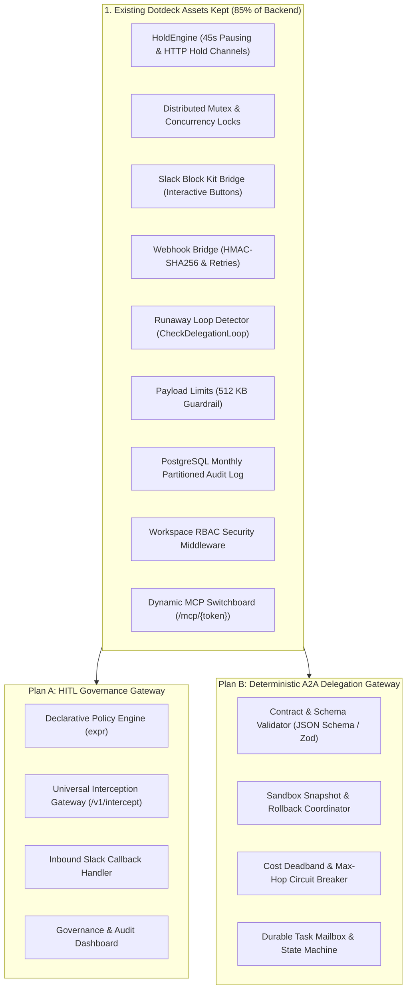

# Plan 12: Strategic Pivot: HITL Governance Gateway (Plan A) & Deterministic A2A Delegation Switchboard (Plan B)

**Status:** Upcoming [ ]

## Objective
Provide two concrete, enterprise-grade strategic pivot options for Dotdeck that repurpose existing high-concurrency Go infrastructure ([`HoldEngine`](file:///C:/GithubProjects/Dotdeck/backend/internal/mcp/hold_engine.go), distributed locks, dynamic MCP switchboard, PostgreSQL partitioned audit store, and Slack/Webhook bridges):
- **Plan A (HITL Governance Gateway & Circuit Breaker):** An in-line safety firewall that intercepts high-stakes tool executions (financial transactions, infrastructure mutations, external comms) and pauses agents for human sign-off.
- **Plan B (Deterministic A2A Delegation Switchboard & Contract Gateway):** An infrastructure switchboard that enables autonomous, cross-vendor Agent-to-Agent (A2A) task delegation by eliminating compounding hallucinations, preserving execution sandbox state, and enforcing cost/depth circuit breakers.

---

## Strategic Context & Pivot Rationale (Why Shift?)

### 1. The Market Failure of the Visual Multiplayer Canvas
- **Walled Gardens Won't Federate:** Frontier closed-agent platforms (OpenAI, Anthropic, xAI) have zero incentive to expose low-level inter-agent federation to third-party visual switchboards; they are aggressively building native closed ecosystems.
- **Engineers Reject Visual Canvases for Core Logic:** Software engineers and platform teams do not build production backend logic on visual node graphs (e.g. React Flow). Visual graphs cannot be version-controlled in Git, tested in CI/CD, or audited easily at scale.
- **The "Watching Bots Run" Anti-Pattern:** Synchronous multiplayer visual watching contradicts the fundamental value proposition of AI automation. Humans cannot sit staring at a canvas waiting for a node to turn yellow; human oversight is inherently asynchronous.

### 2. Plan A Rationale: The HITL Iceberg
- **The Broken Binary:** Autonomous agents with 100% write permissions cause catastrophic data destruction, runaway token bills, and prompt injection exploits. Conversely, agents with 0% write permissions destroy automation ROI because humans must redo all the work.
- **Supervised Autonomy is the Solution:** Agents must perform 95% of the heavy lifting autonomously, but pause and request human authorization for high-stakes operations.
- **The Plumbing Trap:** Sending a Slack message via webhook is trivial. Receiving the inbound button callback securely, preventing double-approval race conditions across teammates, persisting execution state across server restarts, and resuming the agent sub-100ms is a 3-week engineering sinkhole that every AI team dreads building in-house.

### 3. Plan B Rationale: The Reality of Autonomous A2A Delegation
- **The "Telephone Game" Collapse:** When Agent A (90% accuracy) delegates to Agent B (90% accuracy), compound reliability drops to 81%. Without contract validation, errors and hallucinations compound exponentially across agent boundaries.
- **State vs. Text Gap:** Autonomous delegation cannot happen via raw natural language chat. Real work requires passing execution context: git commits, filesystem diffs, environment variables, and sandbox boundaries.
- **Recursive Deadlocks & Token Drain:** Autonomous agents without strict hop limits and token budgets enter recursive delegation loops, burning hundreds of dollars arguing over ambiguous subtasks.
- **The Solution:** A deterministic A2A switchboard that treats agent delegation like distributed transaction management with strict schema contracts, state snapshotting, and automatic rollback on failure.

---

## Architectural Delta: Shared Assets Kept



---

## PLAN A: HITL Governance Gateway & Circuit Breaker

### Deliverable A1: Declarative Policy & Rules Engine (Go Backend)
- [ ] Integrate fast, in-memory expression evaluation (`github.com/expr-lang/expr`) into `backend/internal/policy/`.
- [ ] Support dynamic rule definitions without code changes:
  ```yaml
  rules:
    - name: "High-Risk Database Mutation"
      match_tool: "execute_sql"
      condition: "arguments.query contains 'DROP' || arguments.query contains 'DELETE'"
      action: "HOLD_FOR_APPROVAL"
      approvers: ["@devops-leads"]
    - name: "High-Value Financial Refund"
      match_tool: "issue_refund"
      condition: "arguments.amount > 100.00"
      action: "HOLD_FOR_APPROVAL"
      approvers: ["#billing-team"]
  ```
- [ ] Ensure sub-millisecond evaluation latency (<0.05ms per rule).
- [ ] Provide CRUD API for workspace policies: `GET/POST/PUT /api/v1/workspaces/{id}/policies`.

### Deliverable A2: Universal Interception Gateway (`/v1/intercept`)
- [ ] Provide a universal HTTP reverse proxy and MCP endpoint that any agentic framework can route through.
- [ ] Request lifecycle:
  1. Parse tool call name and arguments.
  2. Evaluate against active workspace policies.
  3. If safe: forward request to upstream target or return instant `allow`.
  4. If policy matched: activate `HoldEngine`, pause client HTTP request, and dispatch interactive Slack Block Kit card.
  5. If timeout exceeded: fall back to async webhook queue, store state, and notify client.

### Deliverable A3: Inbound Slack Callback & State Machine (`/api/v1/slack/actions`)
- [ ] Implement public webhook receiver for Slack interactive button payloads (`block_actions`).
- [ ] Verify incoming requests using Slack HMAC-SHA256 signature (`X-Slack-Signature`, `X-Slack-Request-Timestamp`).
- [ ] Enforce distributed concurrency lock:
  - If Operator A clicks "Approve", lock the decision ID in Redis.
  - Immediately update Slack message UI via `chat.update` to show: *"✅ Approved by @OperatorA at 14:02 UTC"*.
  - Reject subsequent clicks by Operator B with an ephemeral warning.
- [ ] Trigger `holdEngine.ResolveLocal` to unblock waiting agent thread within 50ms.

### Deliverable A4: Governance & Audit Console (Frontend)
- [ ] Convert `frontend/` into an enterprise-grade Governance & Audit Dashboard:
  - **Live Approvals Queue:** Real-time list of paused agent runs, countdown SLA timers, risk reasons, and review cards.
  - **Policy Rule Builder:** No-code visual rule creator (Tool Name, Condition, Action, Slack Channel selector).
  - **Circuit Breaker Metrics:** Total Intercepted Actions, Blocked Runaway Loops, Dollars Saved, and Average Human SLA.
  - **Immutable Audit Trail:** Searchable, filterable table of historical tool calls, reasoning traces, approving operators, and timestamps with SOC2 CSV/JSON export.

---

## PLAN B: Deterministic A2A Delegation Switchboard & Contract Gateway

### Deliverable B1: Contract & Schema Enforcement Engine
- [ ] Implement strict schema validation boundary for agent-to-agent task delegation.
- [ ] When Agent A invokes `delegate_task_to_{peer}` via the MCP Switchboard:
  - The switchboard validates Agent A's input payload against the delegatee's registered JSON Schema / Zod contract.
  - If schema validation fails: the request is **rejected immediately at the gateway** before invoking Agent B. A structured diagnostic error is returned to Agent A explaining the missing fields or invalid types so Agent A can self-correct without polluting Agent B's context.
  - If validation passes: the switchboard wraps the payload into an immutable task envelope with a cryptographic trace ID.

### Deliverable B2: Workspace State Snapshotting & Rollback Coordinator
- [ ] Implement state checkpointing prior to task delegation handoffs:
  - Before Agent B receives execution rights, Dotdeck triggers a pre-delegation checkpoint (Git commit SHA, container file diff hash, or workspace state snapshot).
  - If Agent B fails, crashes, or returns an unhandled exception:
    - Dotdeck automatically triggers a state rollback to the pre-delegation checkpoint.
    - Dotdeck notifies Agent A: *"Delegation to Agent B failed at step X with error Y. Environment rolled back to checkpoint Z."*
  - Eliminates cascading file/database corruption caused by rogue delegatees.

### Deliverable B3: Cost Deadbands & Recursion Circuit Breakers
- [ ] Implement strict financial and recursion guards on every delegation tree:
  - **Max Hop Depth:** Default limit of 3 delegation hops (`Agent A -> Agent B -> Agent C`). Any attempt to delegate to a 4th agent trips the circuit breaker.
  - **Task Budget Cap:** Enforce a hard dollar/token ceiling per delegation tree (e.g. `$2.50` maximum spend across all sub-agents).
  - **Cycle Detector:** Expand `CheckDelegationLoop` in `backend/internal/mcp/server.go` to detect indirect circular handoffs (`A -> B -> C -> A`).
  - When a breaker trips: pause execution, park the task on the `HoldEngine`, and page the human operator via Slack.

### Deliverable B4: Durable Task Mailbox & Asynchronous State Machine
- [ ] Upgrade the MCP switchboard with a durable PostgreSQL-backed task queue (`tasks_delegation` table partitioned by workspace):
  - State machine lifecycle: `QUEUED` $\to$ `VALIDATED` $\to$ `CLAIMED` $\to$ `EXECUTING` $\to$ `VERIFYING` $\to$ `COMPLETED` / `ROLLED_BACK`.
  - Supports asynchronous agent handoffs: Agent A can delegate a long-running 15-minute analysis to Agent B, detach cleanly, and receive a webhook or wake-up callback when Agent B finishes.
  - Dead-Letter Queue (DLQ) for unresolvable delegations with human triage drawer.

### Deliverable B5: Multi-Agent Telemetry & Trace Visualizer
- [ ] Repurpose the telemetry drawer into a **Distributed Agent Trace Viewer** (OpenTelemetry style):
  - Span visualization of the delegation waterfall: see latency, token cost, input contract validation, and execution output for each agent in the chain.
  - One-click inspection of inter-agent contract payloads and diff summaries.

---

## Definition of Done (DoD)

### For Plan A (HITL Governance Gateway):
1. **Sub-Millisecond Policy Evaluation:** Declarative rules evaluated dynamically via `expr` in under 0.1ms.
2. **End-to-End Slack Roundtrip:** Protected tool call halted on open HTTP connection, Slack card dispatched, operator clicks "Approve", and agent resumes within 100ms.
3. **Double-Approval Concurrency Lock:** Two concurrent clicks on the same decision result in exactly one execution with distributed lock protection.

### For Plan B (Deterministic A2A Delegation Switchboard):
1. **Contract Boundary Validation:** Malformed delegation payloads are rejected at the gateway with structured self-correction feedback without invoking the downstream agent.
2. **Automatic Workspace Rollback:** A simulated failure in a delegatee agent cleanly triggers environment rollback to the pre-delegation checkpoint.
3. **Budget & Hop Circuit Breaker:** Exceeding either max delegation depth (3 hops) or tree budget ($2.50) instantly arrests execution and alerts the human operator via Slack.
4. **End-to-End Multi-Agent Handoff:** Agent A successfully delegates a task to Agent B via `/mcp/{agent_token}`, schema is validated, task executes, and typed result is returned to Agent A with an immutable trace log in PostgreSQL.
