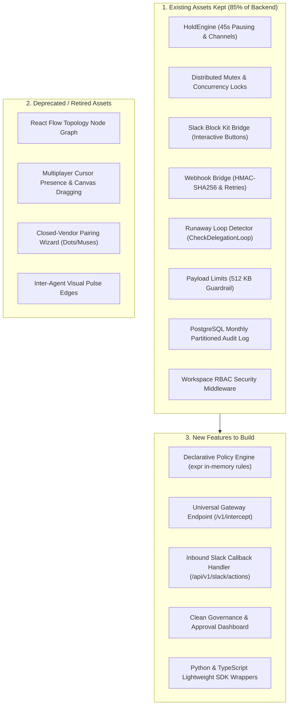

# Plan 11: Strategic Pivot to Human-in-the-Loop (HITL) Execution Gateway & Circuit Breaker

**Status:** Upcoming [ ]

## Objective
Pivot Dotdeck from a visual, multiplayer React Flow switchboard for proprietary closed cloud agents into a headless, enterprise-grade **Human-in-the-Loop (HITL) Execution Gateway & Circuit Breaker**. Transform existing high-concurrency Go infrastructure (Hold Engine, distributed mutexes, Slack Block Kit bridge, and partitioned audit trail) into a drop-in governance proxy that allows engineering teams to deploy autonomous AI agents safely without building bespoke approval plumbing.

---

## Strategic Context & Pivot Rationale (Why Shift?)

### 1. The Market Failure of the Visual Canvas Switchboard
- **Walled Gardens Won't Federate:** Frontier closed-agent platforms (OpenAI, Anthropic, xAI) have zero incentive to expose low-level inter-agent federation to third-party visual switchboards; they are aggressively building native closed ecosystems.
- **Engineers Reject Visual Canvases for Core Logic:** Software engineers and platform teams do not build production backend logic on visual node graphs (e.g. React Flow). Visual graphs cannot be version-controlled in Git, tested in CI/CD, or audited easily at scale.
- **The "Watching Bots Run" Anti-Pattern:** Synchronous multiplayer visual watching contradicts the fundamental value proposition of AI automation. Humans cannot sit staring at a canvas waiting for a node to turn yellow; human oversight is inherently asynchronous.

### 2. The Urgent, Unsolved Enterprise Problem: The HITL Iceberg
- **The Broken Binary:** Autonomous agents with 100% write permissions cause catastrophic data destruction, runaway token bills, and prompt injection exploits. Conversely, agents with 0% write permissions (or that hard-crash on edge cases) destroy automation ROI because humans must redo all the work.
- **Supervised Autonomy is the Solution:** Agents must perform 95% of the heavy lifting autonomously, but pause and request human authorization for high-stakes operations (refunds, database mutations, external emails).
- **The Plumbing Trap:** Sending a Slack message via webhook is trivial (1% of the problem). Receiving the inbound button callback securely, preventing double-approval race conditions across teammates, persisting execution state across server restarts, and resuming the agent sub-100ms is a 3-week engineering sinkhole that every AI team dreads building in-house.

---

## Architectural Delta: Keep vs. Deprecate vs. Build



### Detailed Asset Disposition

| Component | Status | Rationale |
| :--- | :---: | :--- |
| **`HoldEngine`** (`backend/internal/mcp/hold_engine.go`) | **KEEP** | Core synchronous pause-and-resume engine; handles 45s HTTP hold channels and sub-100ms inline resume. |
| **Distributed Locks** (`backend/internal/mcp/`) | **KEEP** | Essential for preventing teammate approval race conditions (two operators clicking "Approve" simultaneously). |
| **Slack Bridge** (`backend/internal/bridge/slack.go`) | **KEEP & EXPAND** | Outbound Block Kit card dispatch already works; needs inbound callback handler for button clicks. |
| **Webhook Bridge** (`backend/internal/bridge/webhook.go`) | **KEEP** | Handles fallback escalation to external systems with HMAC-SHA256 signatures and backoff retries. |
| **Loop Guardrail** (`backend/internal/mcp/server.go`) | **KEEP** | Detects and kills runaway cyclic loops (>5 calls in 10m window) and enforces 512KB payload limits. |
| **Partitioned DB** (`backend/internal/store/migrations/`) | **KEEP** | High-throughput immutable audit trail for compliance (SOC2, EU AI Act). |
| **React Flow Canvas** (`frontend/src/components/canvas/`) | **DEPRECATE** | Replace visual node wiring with a clean Datadog/Stripe Radar-style Governance & Audit Dashboard. |
| **Multiplayer Cursors** (`frontend/src/hooks/useMultiplayerPresence.ts`) | **DEPRECATE** | Unnecessary for asynchronous human approvals; replace with operator assignment badges. |
| **Closed Agent Wizard** (`frontend/src/components/modals/PairingWizard.tsx`) | **REFACTOR** | Replace with standard API Key / MCP URL generation for any agent framework. |

---

## Detailed Deliverables

### Deliverable 1: Declarative Policy & Rules Engine (Go Backend)
- [ ] Integrate fast, in-memory expression evaluation (`github.com/expr-lang/expr`) into `backend/internal/policy/`.
- [ ] Support dynamic rule definitions without code changes:
  ```yaml
  rules:
    - name: "High-Risk Database Mutation"
      match_tool: "execute_sql"
      condition: "arguments.query contains 'DROP' || arguments.query contains 'DELETE'"
      action: "HOLD_FOR_APPROVAL"
      approvers: ["@devops-leads"]
    - name: "High-Value Financial Refund"
      match_tool: "issue_refund"
      condition: "arguments.amount > 100.00"
      action: "HOLD_FOR_APPROVAL"
      approvers: ["#billing-team"]
  ```
- [ ] Ensure sub-millisecond evaluation latency (<0.05ms per rule).
- [ ] Provide CRUD API for workspace policies: `GET/POST/PUT /api/v1/workspaces/{id}/policies`.

### Deliverable 2: Universal Interception Gateway (`/v1/intercept`)
- [ ] Provide a universal HTTP reverse proxy and MCP endpoint that any agentic framework can route through (LangChain, LangGraph, LlamaIndex, OpenAI Assistants, Claude Computer Use, CrewAI).
- [ ] Request lifecycle:
  1. Parse tool call name and arguments.
  2. Evaluate against active workspace policies.
  3. If safe: forward request to upstream target or return instant `allow`.
  4. If policy matched: activate `HoldEngine`, pause client HTTP request, and dispatch interactive Slack Block Kit card.
  5. If timeout exceeded: fall back to async webhook queue, store state, and notify client.

### Deliverable 3: Inbound Slack Callback & State Machine (`/api/v1/slack/actions`)
- [ ] Implement public webhook receiver for Slack interactive button payloads (`block_actions`).
- [ ] Verify incoming requests using Slack HMAC-SHA256 signature (`X-Slack-Signature`, `X-Slack-Request-Timestamp`).
- [ ] Enforce distributed concurrency lock:
  - If Operator A clicks "Approve", lock the decision ID in Redis.
  - Immediately update Slack message UI via `chat.update` to show: *"✅ Approved by @OperatorA at 14:02 UTC"*.
  - Reject subsequent clicks by Operator B with an ephemeral warning (*"Decision already claimed by @OperatorA"*).
- [ ] Trigger `holdEngine.ResolveLocal` or Redis Pub/Sub mesh to unblock the waiting agent thread within 50ms.

### Deliverable 4: Governance & Audit Console (Frontend Redesign)
- [ ] Convert `frontend/` into an enterprise-grade Governance & Audit Dashboard (Stripe Radar / Cloudflare style):
  - **Live Approvals Queue:** Real-time list of paused agent runs, countdown SLA timers, risk reasons, and one-click review cards.
  - **Policy Rule Builder:** No-code visual rule creator (Tool Name, Condition, Action, Slack Channel selector).
  - **Circuit Breaker Metrics:** Cards for Total Intercepted Actions, Blocked Runaway Loops, Dollars Saved, and Average Human Approval Latency.
  - **Immutable Audit Trail:** Searchable, filterable table of all historical tool calls, reasoning traces, approving operators, and timestamps with one-click SOC2 CSV/JSON export.

### Deliverable 5: Zero-Config Client SDKs (Python & TypeScript)
- [ ] **Python SDK (`dotdeck-python`)**:
  ```python
  from dotdeck import DotdeckGuard

  guard = DotdeckGuard(api_key="dd_live_xxx", workspace_id="prod")

  @guard.protect(tool_name="issue_refund")
  def issue_refund(customer_id: str, amount: float):
      # Automatically paused and routed to Slack if amount > threshold
      return stripe.Refund.create(customer=customer_id, amount=amount)
  ```
- [ ] **TypeScript SDK (`@dotdeck/guard`)**: Drop-in wrapper for LangChain tools and Vercel AI SDK.

---

## Definition of Done (DoD)

1. **Sub-Millisecond Policy Evaluation:** Declarative rules evaluated dynamically via `expr` in under 0.1ms without hardcoded variable names.
2. **End-to-End Slack Roundtrip:** 
   - Python/Go client calls protected tool.
   - Request halts with open HTTP connection.
   - Interactive Slack Block Kit message appears in test channel.
   - Operator clicks "Approve" in Slack.
   - Inbound webhook verifies HMAC signature, claims distributed lock, updates Slack card, and unblocks agent HTTP request within 100ms.
3. **Double-Approval Prevention:** Concurrent clicks from two separate users on the same Slack button result in exactly one execution and an error notice on the second click.
4. **Zero-Code Dashboard Rule Creation:** Creating a new rule in the dashboard takes effect immediately across all live agent calls without restarting the backend.
5. **Zero Single-Character Identifiers & Google Docstrings:** All new Go code strictly adheres to project coding standards.